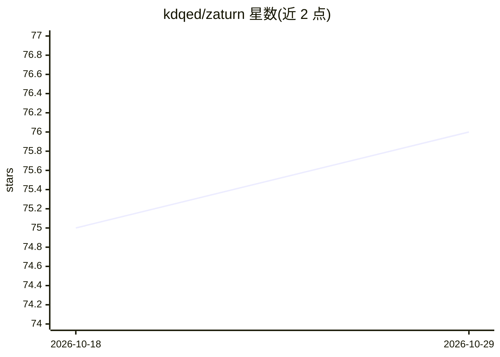

# kdqed/zaturn

⭐ 76 · Python · MIT · 推送 2025-11-12 · [GitHub](https://github.com/kdqed/zaturn) · [官网](https://zaturn.kdqed.com) · 个人维护

**让 AI 直接对数据库执行 SQL 的数据分析工具（MCP/网页界面）**

面向数据分析用户的工具：以 MCP 服务器或类 Jupyter Notebook 的网页界面两种形式提供，让 AI 模型代替用户编写并运行 SQL，无需掌握 SQL 或 Python。支持连接 PostgreSQL、SQLite、DuckDB、MySQL、ClickHouse、SQL Server、BigQuery 等数据库及 CSV、Parquet 文件，除表格外还可生成散点图、直方图、箱线图、密度热力图等多种可视化。安装与配置步骤指向外部文档站点 zaturn.pro，README 本身未给出安装命令。

## 筛选速览

| 维度 | 判定 | 备注 |
|---|---|---|
| AI 角色 | `ai-ecosystem` | LLM/agent 周边工具 |
| 许可风险 | `permissive` | MIT |
| 部署形态 | `None` |  |
| 模型依赖 | — | README 未给出锁定关系 |
| 硬件要求 | — | 无带数字的原话,不猜 |
| 安装摩擦 | `low` | 无编译、无系统依赖或容器化 |
| 成熟度 | — | 结构信号不足 |

## 能力要点

- 以 MCP 服务器或类 Jupyter 网页界面两种形式使用
- 支持 7 种 SQL 数据库与 CSV/Parquet 文件连接
- 生成散点、直方图、箱线、密度热力图等多种可视化
- AI 模型代为编写并执行 SQL，用户无需写代码

## 适用场景

- 不写 SQL/Python 直接通过对话分析数据库数据
- 作为 MCP 工具接入 AI 客户端做数据分析
- 对 CSV/Parquet 文件做交互式探索与可视化

## 场景标签

`数据分析` · 领域:效率与自动化

## 证据(README 行号)

> L5: Zaturn provides tools that enable AI models to run SQL, so you don't have to. It can be used as an MCP or as a web i
> L15: Zaturn can currently connect to the following data sources:

## 星数曲线

2026-10-18 75 → 2026-10-29 76（+1）

---
*卡片 v1 · prompt 1.4 · 生成 2026-10-24 · 置信度 mid · 依据 README sha `da760338eccd` · [字段定义](../../DATASET.md)*
