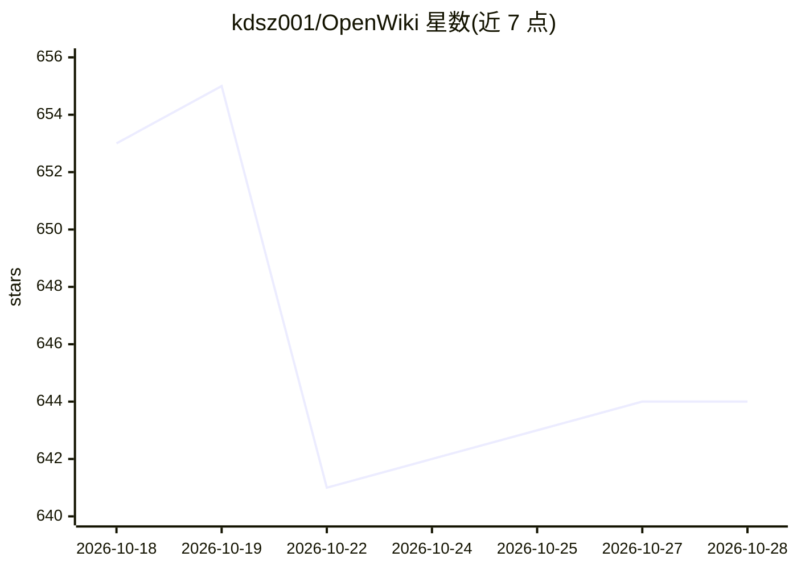

# kdsz001/OpenWiki

⭐ 645 · Rust · MIT · 推送 2026-10-07 · [GitHub](https://github.com/kdsz001/OpenWiki) · [官网](https://openwiki.pages.dev) · 个人维护 · 中文 README

**Mac/Windows 桌面个人知识管理工具：剪藏内容由 AI 整理成 Wiki**

面向个人用户的桌面剪藏与知识管理应用（Tauri + Rust + React）：复制内容时弹出捕获窗口，用户主动选择保留后，由 AI 自动整理成 Wiki 页面（概念/实体/主题），提供知识图谱可视化、基于知识库的问答侧栏与七维度注意力分析的 AI 周报。支持 Anthropic/OpenAI/Gemini 三家提供商，API Key 或 OAuth 登录；数据存储于本地 SQLite。提供 macOS（Apple Silicon/Intel）与 Windows 安装包，macOS 版已签名公证。

## 筛选速览

| 维度 | 判定 | 备注 |
|---|---|---|
| AI 角色 | `ai-native` | 本体是模型或模型工具 |
| 许可风险 | `permissive` | MIT |
| 部署形态 | `desktop` | 安装包/桌面程序 |
| 模型依赖 | locked-api |  |
| 硬件要求 | — | 无带数字的原话,不猜 |
| 安装摩擦 | `low` | 无编译、无系统依赖或容器化 |
| 成熟度 | — | 结构信号不足 |

## 能力要点

- 剪贴板捕获弹窗，仅保存用户主动选择保留的内容
- AI 自动将捕获内容编译为 Wiki 页面并生成知识图谱
- 支持 Anthropic (Claude) / OpenAI / Google Gemini，可选各家模型
- 全部数据存储于本地 SQLite，提供 Markdown 一键导出

## 适用场景

- 日常浏览时随手剪藏文本、图片和链接，逐步积累个人知识库
- 对自己收藏的内容提问并获得基于知识库的 AI 回答
- 通过 AI 周报回顾一周的信息摄入习惯

## 场景标签

`知识库管理` `文档问答` · 领域:知识与检索

## 证据(README 行号)

> L42: - AI automatically compiles captured content into Wiki pages (concepts, entities, topics)
> L44: - **Ask sidebar** — ask questions about your knowledge base, AI answers based on your content
> L54: - Supports **Anthropic (Claude)** / **OpenAI** / **Google Gemini**

## 星数曲线

2026-10-18 653 → 2026-10-28 644（-9）

---
*卡片 v1 · prompt 1.4 · 生成 2026-10-21 · 置信度 high · 依据 README sha `5cdfc2ee8833` · [字段定义](../../DATASET.md)*
