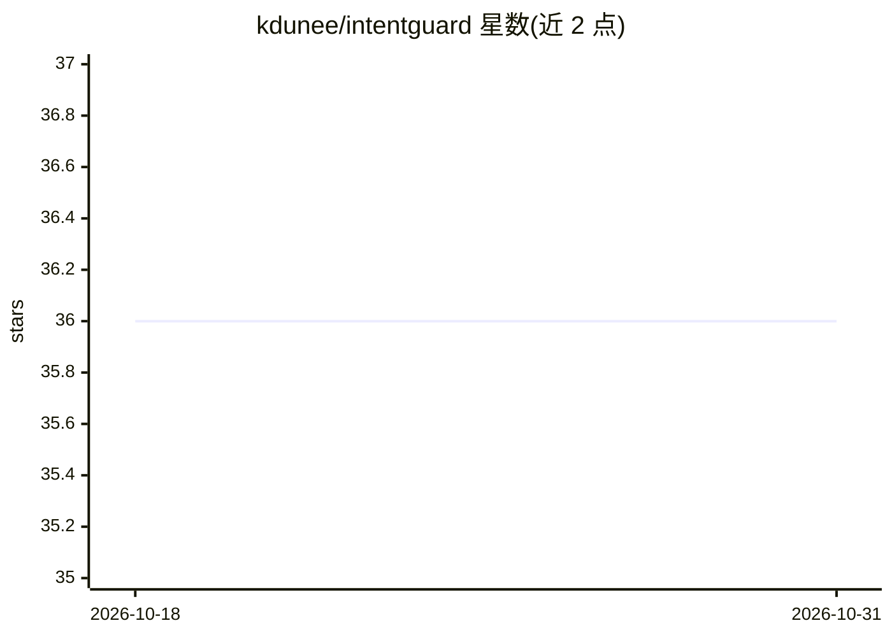

# kdunee/intentguard

⭐ 36 · Python · MIT · 推送 2026-05-24 · [GitHub](https://github.com/kdunee/intentguard) · [官网](https://pypi.org/project/intentguard/) · 个人维护

**用自然语言断言验证代码属性的 Python 测试库**

面向 pytest/unittest 的 Python 测试库：以自然语言描述代码属性（如公共方法需有文档、API 需先校验输入），assert_code() 将引用代码转为源码片段、构建结构化提示，交由本地模型多次评估并按严格多数投票判定，失败抛 AssertionError。默认模型 IntentGuard-1-qwen2.5-coder-1.5b（基于 Qwen2.5-Coder-1.5B 微调），经 llamafile 本地运行，默认不向托管 API 发送代码。结果带缓存与低温采样以趋近可复现，但作者声明非保证确定。需 Python 3.10+。

## 筛选速览

| 维度 | 判定 | 备注 |
|---|---|---|
| AI 角色 | `ai-native` | 本体是模型或模型工具 |
| 许可风险 | `permissive` | MIT |
| 部署形态 | `library` | 以包/库形式分发 |
| 模型依赖 | — | README 未给出锁定关系 |
| 硬件要求 | — | 无带数字的原话,不猜 |
| 安装摩擦 | `medium` | 含编译或系统依赖之一 |
| 成熟度 | — | 结构信号不足 |

## 能力要点

- 自然语言断言 + 多次评估 + 严格多数投票判定，失败抛 AssertionError
- 默认模型 IntentGuard-1-qwen2.5-coder-1.5b，验证集准确率 92.5%
- 通过 llamafile 本地运行模型，默认不发送代码到托管 API
- 支持 pytest 与 unittest，提供缓存与可复现性配置

## 适用场景

- 用自然语言检查架构规则、安全实践、文档契约等横切属性
- 替代噪音大的自定义 AST 遍历或 linter 规则
- 在现有 pytest/unittest 套件中补充意图层面的断言

## 场景标签

`代码审查` · 领域:编码与开发

## 证据(README 行号)

> L13: Use it when a property is real and test-worthy, but awkward to encode with ordinary assertions: architecture rules,

## 星数曲线

2026-10-18 36 → 2026-10-31 36（+0）

---
*卡片 v1 · prompt 1.4 · 生成 2026-10-25 · 置信度 high · 依据 README sha `9e2d0ba12525` · [字段定义](../../DATASET.md)*
