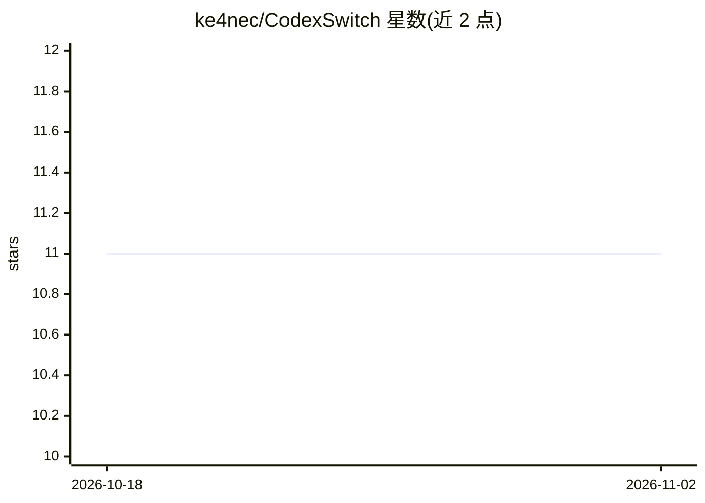

# ke4nec/CodexSwitch

⭐ 11 · Go · 推送 2026-04-02 · [GitHub](https://github.com/ke4nec/CodexSwitch) · [官网](https://github.com/ke4nec/CodexSwitch/releases) · 个人维护 · 中文 README

**跨平台桌面工具：管理并一键切换 Codex 账号与 OpenAI API 配置**

基于 Wails + Go + Vue 构建的跨平台桌面应用，用于管理多个 Codex 配置：扫描 ~/.codex 目录识别官方账号与 API 配置，纳入本地托管列表后执行导入、编辑、切换、删除，并把目标配置写回 Codex 目录，减少手工修改 auth.json / config.toml。支持额度刷新、延迟与可用性测试、中英双语界面。官方为 Linux/Windows amd64 与 macOS amd64/arm64 提供发布产物，也可从源码构建。

## 筛选速览

| 维度 | 判定 | 备注 |
|---|---|---|
| AI 角色 | `ai-ecosystem` | LLM/agent 周边工具 |
| 许可风险 | `none` | — |
| 部署形态 | `library` | 以包/库形式分发 |
| 模型依赖 | — | README 未给出锁定关系 |
| 硬件要求 | — | 无带数字的原话,不猜 |
| 安装摩擦 | `low` | 无编译、无系统依赖或容器化 |
| 成熟度 | — | 结构信号不足 |

## 能力要点

- 官方账号导入与多 API 配置的创建、编辑、一键切换
- 写回目标 Codex 目录，替代手工修改 auth.json / config.toml
- 官方账号额度刷新与配置延迟、可用性检测
- Windows / macOS / Linux 跨平台发布产物

## 适用场景

- 在多个 Codex 官方账号之间快速切换
- 同时维护官方账号与多个 OpenAI API Key、模型组合
- 随时确认账号额度、状态与可用性

## 场景标签

 · 领域:开发者工具/AI 配置管理

## 证据(README 行号)

> L31: 它把“当前正在使用的 Codex 配置目录”和“本地托管的多个账号/API 配置”连接起来，让你可以在官方账号与自定义 API 配置之间快速切换、统一查看状态，并减少手工修改 `auth.json` / `config.toml`
> L80:  直接把选中的配置写回目标 Codex 目录，不再手工改配置文件。

## 星数曲线

2026-10-18 11 → 2026-11-02 11（+0）

---
*卡片 v1 · prompt 1.4 · 生成 2026-11-02 · 置信度 mid · 依据 README sha `c02f8d6f7de6` · [字段定义](../../DATASET.md)*
