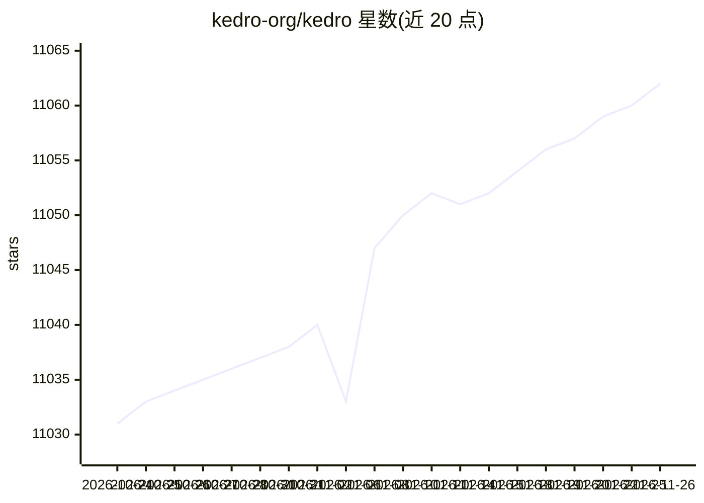

# kedro-org/kedro

⭐ 11,062 · Python · NOASSERTION · 推送 2026-11-25 · [GitHub](https://github.com/kedro-org/kedro) · [官网](https://kedro.org) · 组织维护

**为数据科学团队构建可复现、模块化的数据管线框架**

由 LF AI & Data Foundation 托管的开源 Python 框架，用软件工程最佳实践组织数据工程与数据科学管线。核心机制包括基于 Cookiecutter Data Science 的项目模板、跨本地/网络文件系统与云对象存储读写数据的 Data Catalog（含数据与模型版本管理）、自动解析纯 Python 函数依赖的管线抽象与 Kedro-Viz 可视化，以及 pytest/Sphinx/ruff 编码规范；部署支持单机或分布式，并提供 Argo、Prefect、Kubeflow、AWS Batch、Databricks 等部署方案。通过 PyPI、conda 或源码安装。

## 筛选速览

| 维度 | 判定 | 备注 |
|---|---|---|
| AI 角色 | `ai-ecosystem` | LLM/agent 周边工具 |
| 许可风险 | `none` | NOASSERTION |
| 部署形态 | `library` | 以包/库形式分发 |
| 模型依赖 | — | README 未给出锁定关系 |
| 硬件要求 | — | 无带数字的原话,不猜 |
| 安装摩擦 | `low` | 无编译、无系统依赖或容器化 |
| 成熟度 | — | 结构信号不足 |

## 能力要点

- 项目模板与管线抽象：依赖自动解析 + Kedro-Viz 可视化
- Data Catalog 支持多文件格式/文件系统及数据与模型版本管理
- 部署支持 Argo、Prefect、Kubeflow、AWS Batch、Databricks
- 内置 pytest/Sphinx/ruff 等编码规范支持

## 适用场景

- 把 notebook 与一次性脚本重构为可维护的管线代码
- 团队协作场景下统一数据科学工程的代码规范
- 将数据管线部署到单机或分布式环境

## 场景标签

`MLOps` · 领域:训练与推理

## 证据(README 行号)

> L20: Kedro is a toolbox for production-ready data engineering and data science pipelines. It uses software engineering b
> L22: Kedro is an open-source Python framework hosted by the LF AI & Data Foundation.
> L54: |Pipeline Abstraction|Automatic resolution of dependencies between pure Python functions and data pipeline visualis

## 星数曲线

2026-10-24 11,031 → 2026-11-26 11,062（+31）

---
*卡片 v1 · prompt 1.4 · 生成 2026-11-22 · 置信度 high · 依据 README sha `6b5e537919d1` · [字段定义](../../DATASET.md)*
