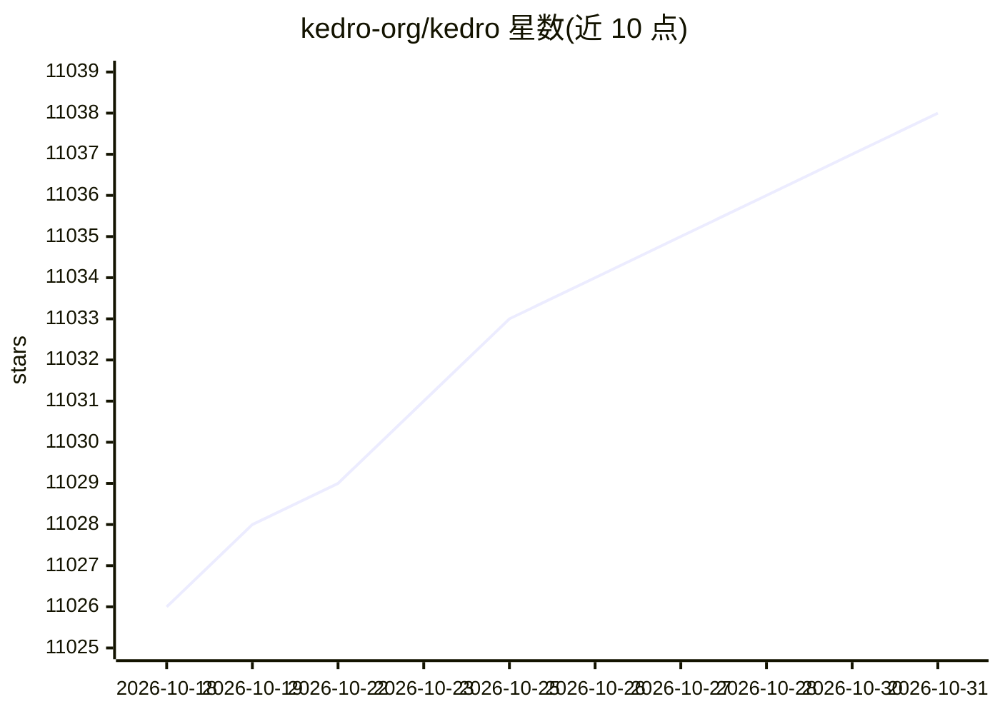

# kedro-org/kedro

⭐ 11,038 · Python · NOASSERTION · 推送 2026-10-28 · [GitHub](https://github.com/kedro-org/kedro) · [官网](https://kedro.org) · 组织维护

**面向生产级数据科学与数据工程的 Python 管道框架**

LF AI & Data Foundation 托管的开源 Python 框架，用于构建可复现、可维护、模块化的数据工程与数据科学管道。核心机制包括：基于 Cookiecutter Data Science 的项目模板、覆盖多种文件格式/文件系统/云对象存储/HDFS 的 Data Catalog 数据连接器（含数据与模型版本控制）、自动解析函数依赖的管道抽象与 Kedro-Viz 可视化，以及到 Argo、Prefect、Kubeflow、AWS Batch、Databricks 的部署支持。面向数据科学与工程团队，定位解决 Jupyter notebook、一次性脚本与胶水代码的可维护性不足问题。

## 筛选速览

| 维度 | 判定 | 备注 |
|---|---|---|
| AI 角色 | `ai-ecosystem` | LLM/agent 周边工具 |
| 许可风险 | `none` | NOASSERTION |
| 部署形态 | `library` | 以包/库形式分发 |
| 模型依赖 | — | README 未给出锁定关系 |
| 硬件要求 | — | 无带数字的原话,不猜 |
| 安装摩擦 | `low` | 无编译、无系统依赖或容器化 |
| 成熟度 | — | 结构信号不足 |

## 能力要点

- 标准项目模板与 Data Catalog 多源数据连接器（含数据/模型版本控制）
- 自动解析依赖的管道抽象与 Kedro-Viz 可视化
- 支持部署到 Argo/Prefect/Kubeflow/AWS Batch/Databricks
- 遵循 CPython 维护版本的 Python 版本支持策略

## 适用场景

- 把一次性 notebook 和脚本重构为可维护的 ML 管道
- 团队协作下统一数据科学项目的工程规范
- 将数据/ML 管道部署到分布式或云端工作流平台

## 场景标签

`工作流自动化` `MLOps` · 领域:效率与自动化

## 证据(README 行号)

> L20: Kedro is a toolbox for production-ready data engineering and data science pipelines. It uses software engineering b
> L54: |Pipeline Abstraction|Automatic resolution of dependencies between pure Python functions and data pipeline visualis
> L56: |Flexible Deployment|Deployment strategies that include single or distributed-machine deployment as well as additio

## 星数曲线

2026-10-18 11,026 → 2026-10-31 11,038（+12）

---
*卡片 v1 · prompt 1.4 · 生成 2026-10-20 · 置信度 high · 依据 README sha `0b51194e1182` · [字段定义](../../DATASET.md)*
