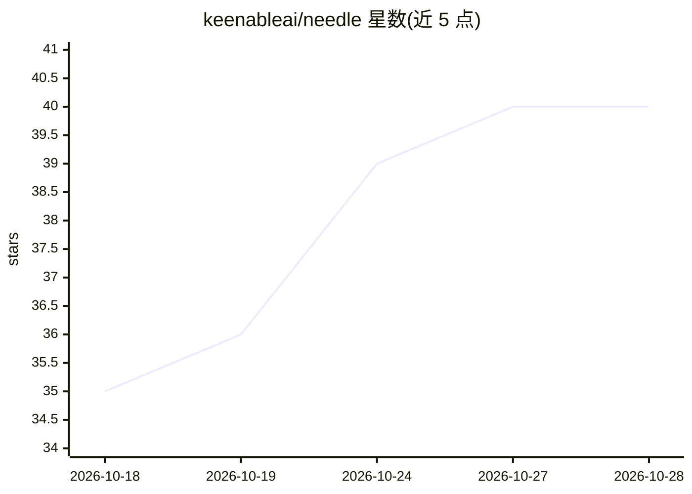

# keenableai/needle

⭐ 40 · Python · MIT · 推送 2026-10-28 · [GitHub](https://github.com/keenableai/needle) · [官网](https://keenableai.github.io/needle/) · 组织维护

**面向搜索引擎的实时检索评测基准套件（5 个基准）**

由 Keenable.ai 维护的搜索与检索评测基准：每个基准由查询集加评分方法构成，统一提供 generate/run 两个子命令。包含 news（实时 RSS+Google Trends 查询、LLM 判分 nDCG@5）、finance（公司财务事实、确定性 answer-recall）、scholar（按 title/body/clue/tot 四桶的论文已知项检索）、legal（判例与 eCFR 检索）、agentic_rare（罕见词查询）五个基准，黄金数据从公共源按需生成，仓库不提交。支持 keenable、exa、brave、tavily 等约 20 个引擎逐一评测，LLM 工作统一经 OpenRouter。安装使用 uv。

## 筛选速览

| 维度 | 判定 | 备注 |
|---|---|---|
| AI 角色 | `ai-ecosystem` | LLM/agent 周边工具 |
| 许可风险 | `permissive` | MIT |
| 部署形态 | `None` |  |
| 模型依赖 | locked-api |  |
| 硬件要求 | — | 无带数字的原话,不猜 |
| 安装摩擦 | `low` | 无编译、无系统依赖或容器化 |
| 成熟度 | — | 结构信号不足 |

## 能力要点

- 5 个基准（news/finance/scholar/legal/agentic_rare），查询集+评分方法模块化
- 黄金数据按需从 RSS、SEC XBRL、CourtListener 等公共源生成
- 支持约 20 个搜索引擎逐一请求，延迟可横向比较
- finance/scholar/legal 评分以确定性匹配为主，LLM 仅作后备或判分

## 适用场景

- 横向评测多个搜索/检索 API 的排序质量
- 构建持续运行的实时检索回归基准
- 研究关键词 vs 自然语言 vs 语义检索的能力差异

## 场景标签

`模型评测` · 领域:评测与运维

## 证据(README 行号)

> L6: Search and retrieval benchmarks from Keenable.ai. A
> L12: needle <benchmark> run --queries queries.jsonl ...    # evaluate engines on them (JSON report)

## 星数曲线

2026-10-18 35 → 2026-10-28 40（+5）

---
*卡片 v1 · prompt 1.4 · 生成 2026-10-25 · 置信度 high · 依据 README sha `c35ed959aa5a` · [字段定义](../../DATASET.md)*
