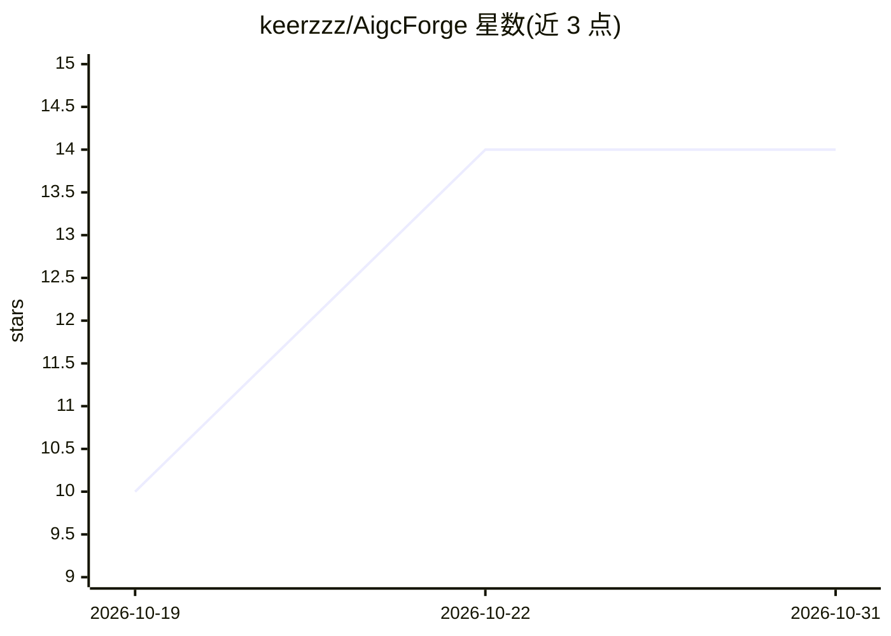

# keerzzz/AigcForge

⭐ 14 · TypeScript · MIT · 推送 2026-10-21 · [GitHub](https://github.com/keerzzz/AigcForge) · 个人维护 · 中文 README

**面向软件工程与知识创作的统一 Agentic 工作台**

开源的统一 Agentic 工作区，提供 5 种产品模式：Coding（AI 开发，含 AST 级补丁、Git worktree、验证门）、Chat（把对话沉淀为 7 类可复用资产）、Work（面向 12 类 IT 角色与创作者的结构化交付）、Assistant（个人调度与知识库）与在审的 Custom 模式。基于 Effect-TS 运行时与事件溯源 Session V2，可经 ACP/SDK/JSONL 调度 Claude Code、Codex、Gemini、opencode 等外部 CLI，LLM 层支持 OpenAI、Claude、Gemini、DeepSeek、Ollama 等多提供商路由。Monorepo 含 18 个包，桌面端为 Electron Shell 加终端 UI。部分多参与者流水线能力仍在 ADR 规划中未发布。

## 筛选速览

| 维度 | 判定 | 备注 |
|---|---|---|
| AI 角色 | `ai-native` | 本体是模型或模型工具 |
| 许可风险 | `permissive` | MIT |
| 部署形态 | `desktop` | 安装包/桌面程序 |
| 模型依赖 | local-ok | 支持本地模型 |
| 硬件要求 | — | 无带数字的原话,不猜 |
| 安装摩擦 | `low` | 无编译、无系统依赖或容器化 |
| 成熟度 | `idea` | |

## 能力要点

- 5 种产品模式：Coding/Chat/Work/Assistant/Custom（在审）
- 外部 CLI 调度（ACP/官方 SDK/JSONL 三层通道）支持 claude-code、codex、gemini、opencode
- Effect-TS 事件溯源运行时：Session V2、确定性回放、SQLite 事务持久化
- Harness 7 层防幻觉验证环（死循环检测、Verifier Gate、多模型仲裁等）
- LLM 抽象层支持 OpenAI、Claude、Gemini、DeepSeek、Ollama 等多提供商路由

## 适用场景

- 在统一工作台中完成 AI 辅助编码、测试与调试
- 把 AI 对话经验固化为 prompt、skill、MCP 等 7 类可复用项目资产
- 非编程角色（PO/BA/UI 等）使用领域预设做结构化交付
- 通过 meta 编排器与外部 CLI 协作处理子任务

## 场景标签

`工作流自动化` `编码 Agent` `AI 助手` · 领域:效率与自动化

## 证据(README 行号)

> L23: **AigcForge** is far more than a single coding terminal; it is a **Unified Agentic Workspace**.
> L29: - **External CLI Dispatch**: Seamlessly orchestrate built-in agents alongside top-tier external CLIs like Claude Co

## 星数曲线

2026-10-19 10 → 2026-10-31 14（+4）

---
*卡片 v1 · prompt 1.4 · 生成 2026-10-31 · 置信度 high · 依据 README sha `365d88aa94ab` · [字段定义](../../DATASET.md)*
