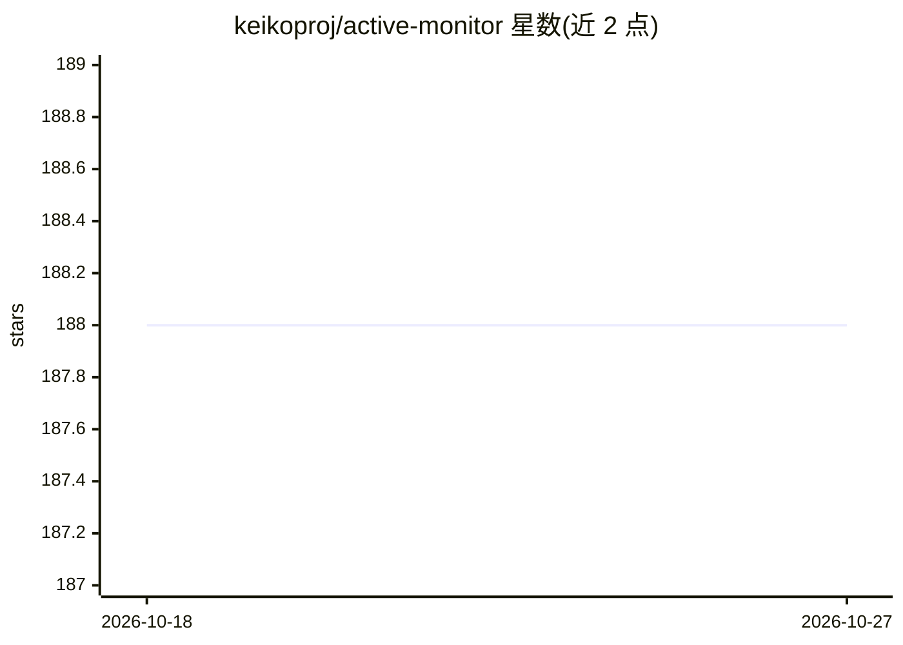

# keikoproj/active-monitor

⭐ 188 · Go · Apache-2.0 · 推送 2026-10-01 · [GitHub](https://github.com/keikoproj/active-monitor) · 组织维护

**给运维：基于 Argo 工作流的 Kubernetes 集群深度监控与自愈控制器**

Active-Monitor 是一个 Kubernetes 自定义资源控制器，以 HealthCheck CR 的形式封装 Argo 工作流，按 repeatAfterSec 或 cron 周期执行集群健康检查（对象创建、DNS 解析、Pod 状态、存储容量等），检查失败时自动触发 Remedy 工作流修复，并通过 RemedyRunsLimit 与 RemedyResetInterval 控制重试。控制器在 :8080/metrics 导出 Prometheus 指标，也支持工作流输出的自定义指标。运行依赖 Go、kubectl、Kubernetes 集群访问与 Argo Workflows 控制器。

## 筛选速览

| 维度 | 判定 | 备注 |
|---|---|---|
| AI 角色 | `ai-enhanced` | 去掉 AI 部分产品仍成立 |
| 许可风险 | `permissive` | Apache-2.0 |
| 部署形态 | `None` |  |
| 模型依赖 | — | README 未给出锁定关系 |
| 硬件要求 | — | 无带数字的原话,不猜 |
| 安装摩擦 | `low` | 无编译、无系统依赖或容器化 |
| 成熟度 | — | 结构信号不足 |

## 能力要点

- HealthCheck/Remedy 为 Argo 工作流的封装，按周期执行并更新 CR 状态
- 检查失败自动触发 Remedy 修复，支持重试上限与重置间隔
- 导出 Prometheus 指标（成功/失败计数、执行耗时）并支持自定义指标
- 支持 Namespace 与 Cluster 两个级别的权限绑定

## 适用场景

- 周期性验证集群网络连通性、存储与关键 Pod 状态
- 健康检查失败时自动执行修复工作流
- 通过 Prometheus 指标接入告警与通知系统

## 场景标签

 · 领域:云原生/Kubernetes 运维

## 证据(README 行号)

> L13: Active-Monitor is a Kubernetes custom resource controller which enables deep cluster monitoring and self-healing us
> L172: Active-Monitor controller also exports metrics in Prometheus format which can be further used for notifications an

## 星数曲线

2026-10-18 188 → 2026-10-27 188（+0）

---
*卡片 v1 · prompt 1.4 · 生成 2026-10-22 · 置信度 low · 依据 README sha `b6b0ce1447bf` · [字段定义](../../DATASET.md)*
