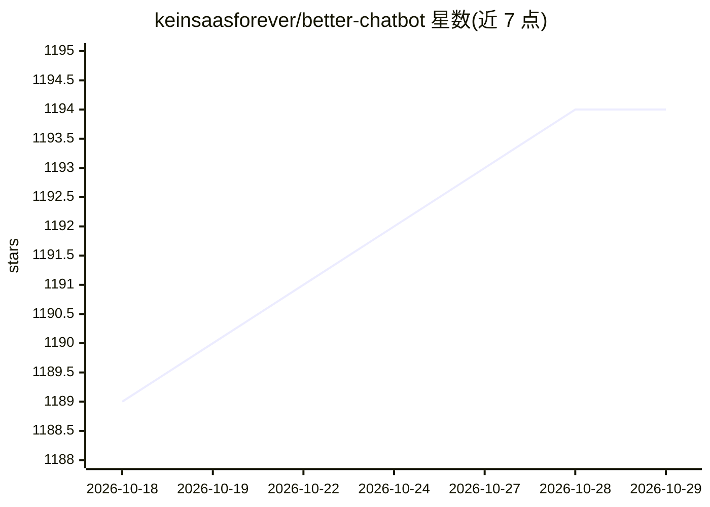

# keinsaasforever/better-chatbot

⭐ 1,194 · TypeScript · MIT · 推送 2026-08-19 · [GitHub](https://github.com/keinsaasforever/better-chatbot) · [官网](https://app.keinsaas.com/) · 个人维护

**面向个人与团队的开源 AI 聊天工作台，支持 MCP 与自动化**

基于 Next.js 与 Vercel AI SDK 构建的开源聊天应用（原 better-chatbot，现名 Keinsaas Navigator）：接入 OpenAI、Anthropic、Google、xAI、Ollama 等多家模型提供商，需至少一个 API key。功能包括 MCP 协议工具调用、网页搜索（Exa）、JS/Python 执行、AI 图像生成、可视化工作流、自定义 agent、实时语音助手与团队共享配置。可通过 Vercel 一键部署或 Docker Compose/pnpm 本地运行，数据存储依赖 Postgres 与 Vercel Blob。

## 筛选速览

| 维度 | 判定 | 备注 |
|---|---|---|
| AI 角色 | `ai-native` | 本体是模型或模型工具 |
| 许可风险 | `permissive` | MIT |
| 部署形态 | `self-host` | docker 或自建部署 |
| 模型依赖 | local-ok | 支持本地模型 |
| 硬件要求 | — | 无带数字的原话,不猜 |
| 安装摩擦 | `low` | 无编译、无系统依赖或容器化 |
| 成熟度 | — | 结构信号不足 |

## 能力要点

- 多模型接入（OpenAI/Anthropic/Google/xAI/Ollama 等）
- MCP 协议工具调用与 @mention 快速调用机制
- 可视化工作流与自定义 agent 可发布为聊天内可调用工具
- 内置实时语音助手、网页搜索、图像生成与代码执行

## 适用场景

- 个人或团队搭建自带工具调用能力的 AI 聊天助手
- 通过自定义 agent 与工作流把 MCP 工具组合成自动化流程
- 自托管部署（Vercel/Docker）一个多用户 AI 工作台

## 场景标签

`聊天机器人` `工作流自动化` `语音 Agent` `图像生成` · 领域:效率与自动化

## 证据(README 行号)

> L28: **Keinsaas Navigator** - A better open-source AI chatbot for individuals and teams, inspired by ChatGPT, Claude, Gr
> L30: • **Multi-AI Support** - Integrates all major LLMs: OpenAI, Anthropic, Google, xAI, Ollama, and more
> L39: Built with Vercel AI SDK and Next.js, combining the best features of leading AI services into one platform.

## 星数曲线

2026-10-18 1,189 → 2026-10-29 1,194（+5）

---
*卡片 v1 · prompt 1.4 · 生成 2026-10-21 · 置信度 high · 依据 README sha `3423e0cf15a2` · [字段定义](../../DATASET.md)*
