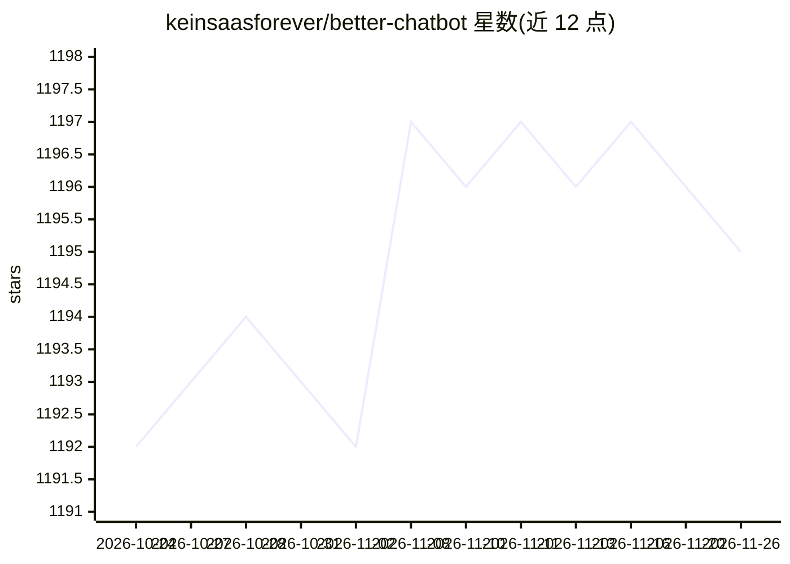

# keinsaasforever/better-chatbot

⭐ 1,195 · TypeScript · MIT · 推送 2026-11-06 · [GitHub](https://github.com/keinsaasforever/better-chatbot) · [官网](https://app.keinsaas.com/) · 组织维护

**自托管的 AI 对话与 agent 工作平台**

keinsaas Navigator（前身 better-chatbot）是一个可自托管的开源 AI 工作区：提供流式对话、文件附件、@提及的 agent、可视化 workflow 编辑器、MCP 服务器连接（HTTP/stdio、OAuth）、定时任务、实时语音与 pgvector 本地检索。模型默认经 Vercel AI Gateway 单 key 接入多家服务商，也可改连 Ollama/LM Studio 或任意 OpenAI 兼容端点。部署支持 Vercel 一键部署、Docker Compose 与本地 pnpm 开发环境；桌面应用（beta）支持本地 stdio MCP。许可证为 MIT。

## 筛选速览

| 维度 | 判定 | 备注 |
|---|---|---|
| AI 角色 | `ai-ecosystem` | LLM/agent 周边工具 |
| 许可风险 | `permissive` | MIT |
| 部署形态 | `self-host` | docker 或自建部署 |
| 模型依赖 | local-ok | 支持本地模型 |
| 硬件要求 | — | 无带数字的原话,不猜 |
| 安装摩擦 | `low` | 无编译、无系统依赖或容器化 |
| 成熟度 | — | 结构信号不足 |

## 能力要点

- agent/skills/workflow 三层组织，@提及即可在对话中调用
- MCP 工具服务器连接（HTTP 与 stdio，含 OAuth）
- pgvector 本地文档检索，无需外部服务
- 单 AI_GATEWAY_API_KEY 接入多家模型，或改连 Ollama/LM Studio 本地模型

## 适用场景

- 在自己的服务器上搭建多模型对话与 agent 工作区
- 用可视化编辑器把 LLM 调用、HTTP、代码步骤编排成 workflow 工具
- 连接 MCP 服务器让 agent 调用自有工具与应用
- 在本地运行模型并让数据不出本机

## 场景标签

`聊天机器人` `工作流自动化` `语音 Agent` · 领域:效率与自动化

## 证据(README 行号)

> L7: **An open-source AI chat and agent platform you can host yourself.**
> L9: Talk to any model, attach your files, connect MCP tool servers, build workflows,
> L174: **MCP tool servers.** Connect any Model Context Protocol server over HTTP or

## 星数曲线

2026-10-24 1,192 → 2026-11-26 1,195（+3）

---
*卡片 v1 · prompt 1.4 · 生成 2026-11-23 · 置信度 mid · 依据 README sha `2ec8e670dc4f` · [字段定义](../../DATASET.md)*
