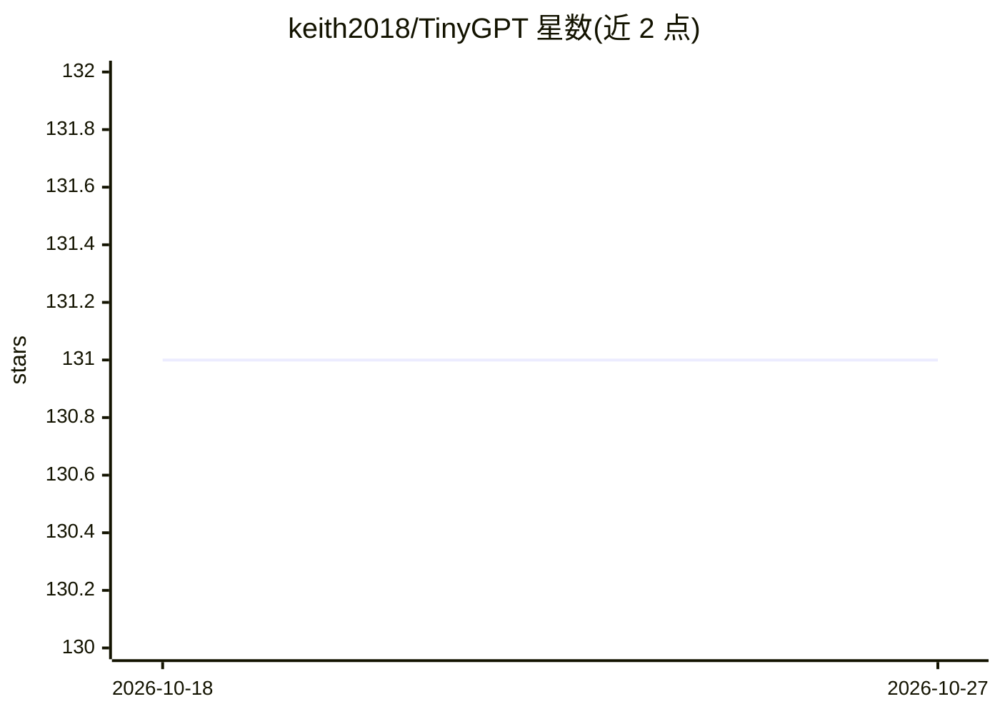

# keith2018/TinyGPT

⭐ 131 · C++ · MIT · 推送 2026-06-23 · [GitHub](https://github.com/keith2018/TinyGPT) · 个人维护

**从零实现的 C++ LLM 推理引擎，含 OpenAI 兼容服务**

用 C++ 从零实现的 LLM 推理引擎：支持 Llama 3.2、Qwen 2.5/3、Mistral 等模型，提供快速 BPE 分词器、CUDA FP32/FP16/BF16 推理、Paged KV Cache、Continuous Batching 与 chunked prefill、TinyFA Flash Attention、基于 NCCL 的多卡张量并行。附带推理示例、OpenAI 兼容 API 服务（/v1/completions、/v1/chat/completions，含内置 Web UI）与 Python 绑定。通过 git clone 源码 + CMake 构建，模型文件从 HuggingFace 下载；张量并行需 --device cuda 且要求模型无 tied word embeddings。

## 筛选速览

| 维度 | 判定 | 备注 |
|---|---|---|
| AI 角色 | `ai-ecosystem` | LLM/agent 周边工具 |
| 许可风险 | `permissive` | MIT |
| 部署形态 | `library` | 以包/库形式分发 |
| 模型依赖 | — | README 未给出锁定关系 |
| 硬件要求 | — | 无带数字的原话,不猜 |
| 安装摩擦 | `high` | 编译与系统依赖俱全 |
| 成熟度 | — | 结构信号不足 |

## 能力要点

- 支持 Llama 3.2 / Qwen 2.5 / Qwen 3 / Mistral 模型推理
- Paged KV Cache、Continuous Batching 与 chunked prefill
- 基于 NCCL 的多 GPU 张量并行（每卡一进程）
- OpenAI 兼容 API 服务与内置 Web UI

## 适用场景

- 本地加载 HuggingFace 模型做 LLM 推理
- 起一个 OpenAI 兼容的服务供现有客户端调用
- 在多 GPU 环境下做张量并行推理

## 场景标签

`推理引擎` · 领域:训练与推理

## 证据(README 行号)

> L3: Tiny C++ LLM inference implementation from scratch.
> L99: TinyGPT includes an OpenAI-compatible API server with a built-in Web UI.
> L129: The server implements the following OpenAI-compatible endpoints:

## 星数曲线

2026-10-18 131 → 2026-10-27 131（+0）

---
*卡片 v1 · prompt 1.4 · 生成 2026-10-22 · 置信度 mid · 依据 README sha `41707eac92d7` · [字段定义](../../DATASET.md)*
