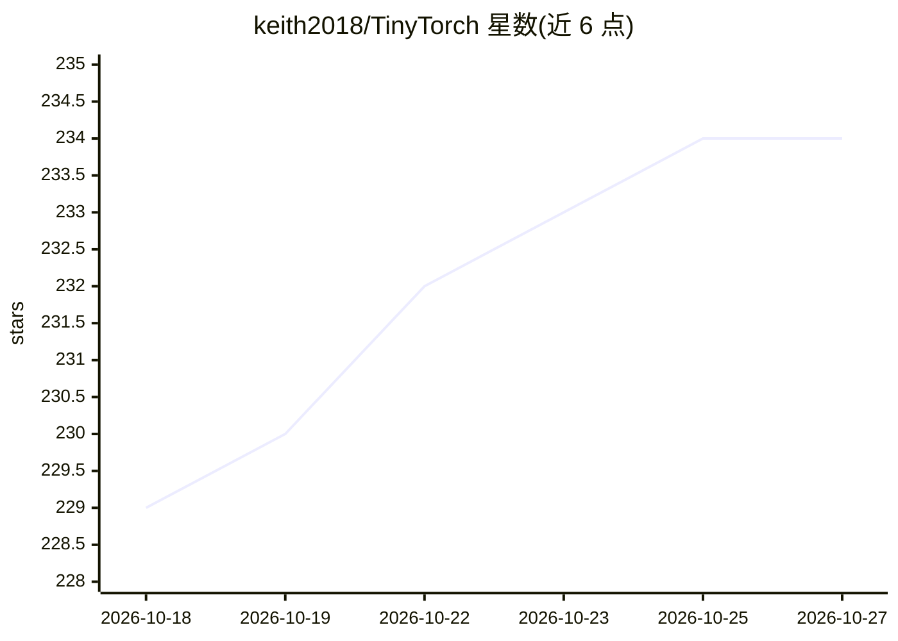

# keith2018/TinyTorch

⭐ 234 · C++ · MIT · 推送 2026-06-23 · [GitHub](https://github.com/keith2018/TinyTorch) · 个人维护

**纯 C++ 从零实现的轻量深度学习训练框架，PyTorch 风格 API**

用 C++17 从零实现的轻量深度学习训练框架，不依赖外部深度学习库。提供 PyTorch 风格 API（Tensor、nn.Module、Optimizer、DataLoader），通过动态计算图与 Function 节点实现自动微分，backward() 按逆拓扑序传播梯度。支持 CPU（BLAS 加速）与 CUDA GPU、FP16/FP32/BF16 混合精度、基于 NCCL 的多机多卡分布式训练，以及 LLaMA/Qwen/Mistral 的 LLM 推理。需 CMake 从源码构建。

## 筛选速览

| 维度 | 判定 | 备注 |
|---|---|---|
| AI 角色 | `ai-ecosystem` | LLM/agent 周边工具 |
| 许可风险 | `permissive` | MIT |
| 部署形态 | `None` |  |
| 模型依赖 | — | README 未给出锁定关系 |
| 硬件要求 | — | 无带数字的原话,不猜 |
| 安装摩擦 | `high` | 编译与系统依赖俱全 |
| 成熟度 | — | 结构信号不足 |

## 能力要点

- 动态计算图自动微分，PyTorch 风格 API
- 纯 C++17 实现，不依赖外部深度学习库
- CPU/CUDA 双后端，FP16/FP32/BF16 混合精度
- NCCL 分布式训练与 LLaMA/Qwen/Mistral 推理支持

## 适用场景

- 学习深度学习框架内部实现原理
- 在资源受限环境用 C++ 训练神经网络
- 多机多 GPU 分布式训练实验

## 场景标签

`模型训练` · 领域:训练与推理

## 证据(README 行号)

> L3: A lightweight deep learning training framework implemented from scratch in C++, featuring a PyTorch-style API.
> L13: - **PyTorch-style API** &mdash; Familiar naming conventions (`Tensor`, `nn.Module`, `Optimizer`, `DataLoader`).
> L14: - **Pure C++ implementation** &mdash; No dependency on external deep learning libraries, C++17 only.

## 星数曲线

2026-10-18 229 → 2026-10-27 234（+5）

---
*卡片 v1 · prompt 1.4 · 生成 2026-10-22 · 置信度 high · 依据 README sha `6e033ab17950` · [字段定义](../../DATASET.md)*
