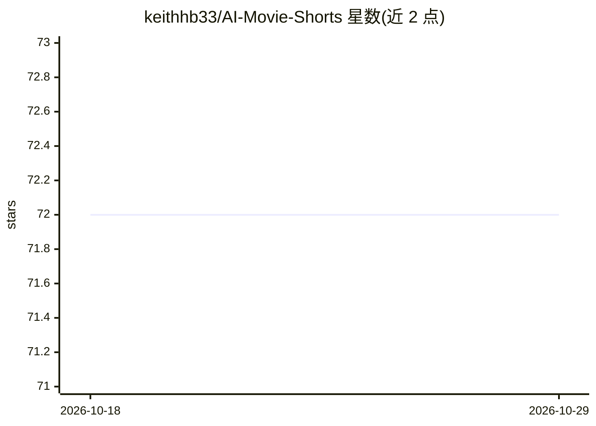

# keithhb33/AI-Movie-Shorts

⭐ 72 · C · 推送 2025-12-15 · [GitHub](https://github.com/keithhb33/AI-Movie-Shorts) · 个人维护

**将整部电影自动转成 AI 解说回顾短视频的桌面工具**

C 编写的桌面应用（raylib UI）：读取 movies/ 目录下的 .mp4 影片，自动下载 SRT 字幕（可选获取剧本作为补充上下文），调用 OpenAI 生成带时间戳的剪辑与解说计划，用 ElevenLabs 生成解说配音，FFmpeg 剪辑、拉伸对齐时长并拼接，输出横版与 9:16 竖版（TikTok）回顾视频，可选混入背景音乐。需自备 OpenAI 与 ElevenLabs API key，源码构建，依赖 FFmpeg、libcurl、cJSON、raylib 等。

## 筛选速览

| 维度 | 判定 | 备注 |
|---|---|---|
| AI 角色 | `ai-native` | 本体是模型或模型工具 |
| 许可风险 | `none` | — |
| 部署形态 | `None` |  |
| 模型依赖 | — | README 未给出锁定关系 |
| 硬件要求 | — | 无带数字的原话,不猜 |
| 安装摩擦 | `high` | 编译与系统依赖俱全 |
| 成熟度 | — | 结构信号不足 |

## 能力要点

- OpenAI 生成剪辑计划（时间戳+解说词），ElevenLabs 生成配音
- FFmpeg 自动剪辑、时长对齐、拼接并输出横版+竖版视频
- 自动下载 SRT 字幕，可选剧本作为故事上下文
- raylib 桌面 UI：一键打开目录、启动生成、日志面板

## 适用场景

- 把长片自动剪成带解说的回顾短视频
- 批量生成适配 TikTok 的 9:16 竖版影视回顾内容
- 自动混入背景音乐生成配音回顾视频

## 场景标签

`视频生成` · 领域:内容生成

## 证据(README 行号)

> L3: Turn full-length `.mp4` movies into **AI-narrated movie recap videos** (horizontal + vertical), built automatically 
> L15: 3. Ask **OpenAI** to generate a **clip plan** (timestamps + narration per clip)
> L16: 4. Use **ElevenLabs** to generate voiceover audio for each clip

## 星数曲线

2026-10-18 72 → 2026-10-29 72（+0）

---
*卡片 v1 · prompt 1.4 · 生成 2026-10-24 · 置信度 high · 依据 README sha `e359049de59b` · [字段定义](../../DATASET.md)*
