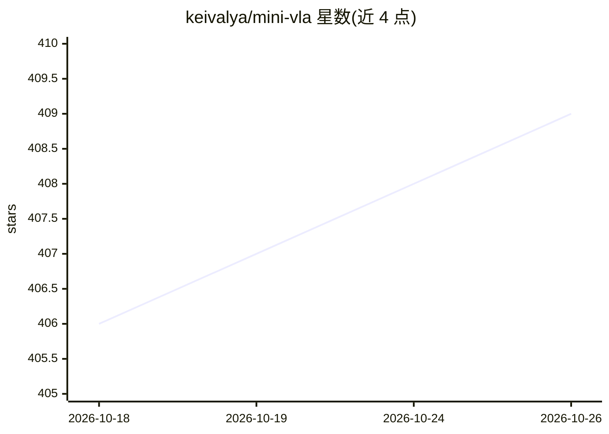

# keivalya/mini-vla

⭐ 409 · Python · MIT · 推送 2026-03-17 · [GitHub](https://github.com/keivalya/mini-vla) · 个人维护

**面向初学者的最小 VLA 模型：融合图像/文本/状态生成机器人动作**

教学用途的 Vision-Language-Action 模型实现：核心代码约 150 行，用 MLP 融合图像、文本指令与机器人状态嵌入，经 diffusion head 生成连续动作。提供数据采集（Meta-World 专家策略）、训练与仿真测试脚本。README 明确声明非生产就绪、不以 SOTA 为目标，定位为可修改的 VLA 学习模板。安装依赖 conda + pip，核心文件仅四个模块，计划后续支持 CLIP/SigLIP 等更大骨干网络与多任务推理。

## 筛选速览

| 维度 | 判定 | 备注 |
|---|---|---|
| AI 角色 | `ai-native` | 本体是模型或模型工具 |
| 许可风险 | `permissive` | MIT |
| 部署形态 | `library` | 以包/库形式分发 |
| 模型依赖 | — | README 未给出锁定关系 |
| 硬件要求 | — | 无带数字的原话,不猜 |
| 安装摩擦 | `low` | 无编译、无系统依赖或容器化 |
| 成熟度 | `idea` | |

## 能力要点

- 核心模型约 150 行代码，覆盖完整训练与执行流程
- diffusion policy 生成连续机器人动作
- 提供专家数据采集、训练、仿真测试三个脚本
- 计划支持 CLIP/SigLIP/ViT 视觉骨干与多任务

## 适用场景

- 初学者理解 VLA 模型的训练与执行管线
- 研究者快速原型化 VLA 设计想法
- 学生学习基于 diffusion 的动作生成

## 场景标签

`教程课程` · 领域:学习与行业

## 证据(README 行号)

> L3: mini-VLA is a minimal, beginner-friendly Vision-Language-Action (VLA) model designed to show how modern robot polici
> L23: The mini-VLA model core is mainly four files: models/encoders.py contains encoders for images, text and states corr

## 星数曲线

2026-10-18 406 → 2026-10-26 409（+3）

---
*卡片 v1 · prompt 1.4 · 生成 2026-10-21 · 置信度 mid · 依据 README sha `38925f51ce10` · [字段定义](../../DATASET.md)*
