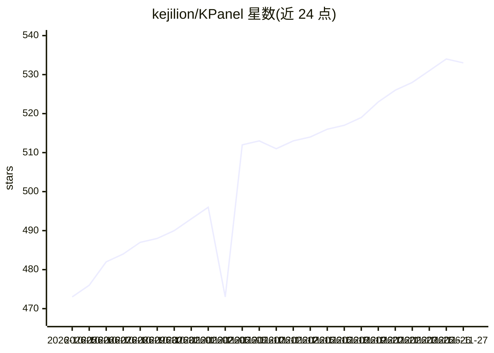

# kejilion/KPanel

⭐ 533 · Go · AGPL-3.0 · 推送 2026-11-26 · [GitHub](https://github.com/kejilion/KPanel) · [官网](https://kpanel.kejilion.sh/) · 个人维护 · 中文 README

**单管理员 Linux 服务器运维面板，含 AI 助手**

KPanel 是与 kejilion.sh 双向互通的开源 Linux 运维面板，面向单管理员的服务器管理场景。提供桌面模式与经典模式两种界面，共享同一账户与主机状态；能力覆盖主机与历史监控、网站与 Nginx 管理、Docker 容器/镜像/Compose 管理、多主机集群接入、远程文件与终端、消息通知及公开只读状态页。内置 AI 助手支持多 Provider、多模型与多会话，通过固定结构化工具查询分析，默认人工审批。面板仅支持 Docker 部署，Agent 与轻量节点可原生运行。

## 筛选速览

| 维度 | 判定 | 备注 |
|---|---|---|
| AI 角色 | `ai-enhanced` | 去掉 AI 部分产品仍成立 |
| 许可风险 | `viral` | AGPL-3.0 |
| 部署形态 | `self-host` | docker 或自建部署 |
| 模型依赖 | — | README 未给出锁定关系 |
| 硬件要求 | — | 无带数字的原话,不猜 |
| 安装摩擦 | `low` | 无编译、无系统依赖或容器化 |
| 成熟度 | — | 结构信号不足 |

## 能力要点

- 桌面与经典双工作模式，共享同一账户与主机状态
- AI 助手支持 OpenAI-compatible、Anthropic、Gemini Provider 与人工审批机制
- 多主机集群管理：监控、远程文件、终端、批量执行与通知
- 管理真实主机状态，不接管 Nginx、Compose 等既有环境

## 适用场景

- 在一台面板上统一监控和管理多台 Linux 服务器
- 管理已有 Docker 容器、Compose 项目与 Nginx 站点
- 通过 AI 助手查询主机状态并获得操作建议
- 通过 Telegram、飞书、钉钉等接收主机告警通知

## 场景标签

 · 领域:服务器运维/基础设施管理

## 证据(README 行号)

> L7:  与 <code>kejilion.sh</code> 双向互通的开源 Linux 运维面板，支持双模式工作台、多主机管理与 AI 助手。
> L92: ## AI 是工作窗口，不是第二套控制面
> L157: 面板本体目前仅支持 Docker 部署；Release 中的 `kejilion-panel-meta-<version>.tar.gz`

## 星数曲线

2026-10-25 473 → 2026-11-27 533（+60）

---
*卡片 v1 · prompt 1.4 · 生成 2026-11-25 · 置信度 high · 依据 README sha `140f8203af58` · [字段定义](../../DATASET.md)*
