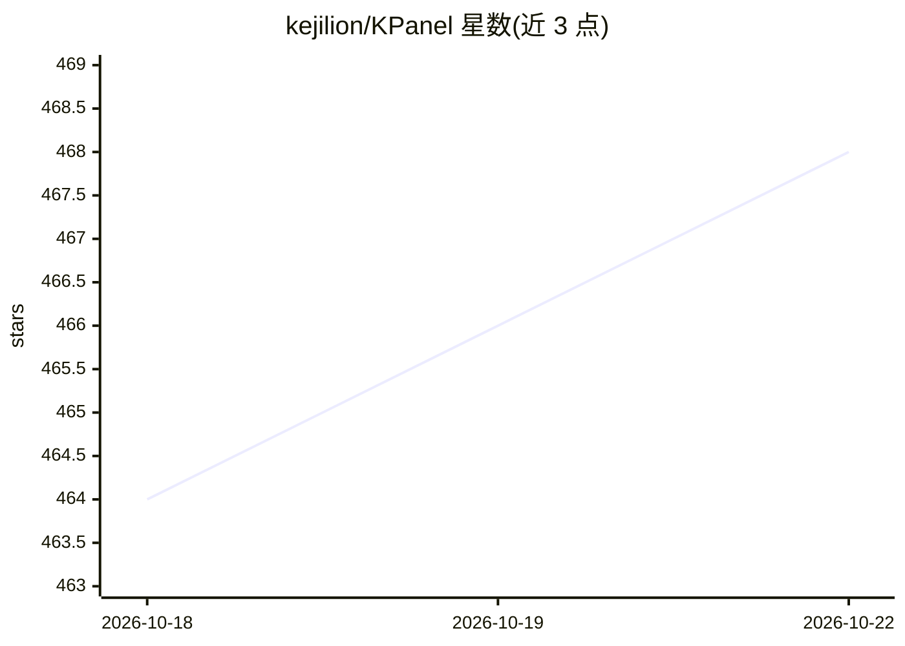

# kejilion/KPanel

⭐ 468 · Go · AGPL-3.0 · 推送 2026-10-21 · [GitHub](https://github.com/kejilion/KPanel) · [官网](https://kpanel.kejilion.sh/) · 个人维护 · 中文 README

**面向单管理员的 Linux 运维面板，支持多主机管理与 AI 助手**

KPanel 是与 kejilion.sh 双向互通的开源 Linux 服务器管理面板，用 Go 编写，提供桌面与经典两种工作模式。功能覆盖主机与历史监控、Nginx 站点管理、Docker 与 Compose 应用管理、文件/终端工作区、多节点集群接入与消息通知。内置 AI 助手支持 OpenAI-compatible、Anthropic 与 Gemini 多 Provider，通过固定结构化工具查询主机状态，默认人工审批。面板仅支持 Docker 部署，需 rootful Docker Engine 与 Compose v2；发布架构为 AMD64/ARM64，目前实机验证仅 Debian 13 AMD64。

## 筛选速览

| 维度 | 判定 | 备注 |
|---|---|---|
| AI 角色 | `ai-enhanced` | 去掉 AI 部分产品仍成立 |
| 许可风险 | `viral` | AGPL-3.0 |
| 部署形态 | `self-host` | docker 或自建部署 |
| 模型依赖 | — | README 未给出锁定关系 |
| 硬件要求 | — | 无带数字的原话,不猜 |
| 安装摩擦 | `low` | 无编译、无系统依赖或容器化 |
| 成熟度 | — | 结构信号不足 |

## 能力要点

- 桌面/经典双模式工作台，共享同一账户与主机状态
- 多 Provider AI 助手，固定结构化工具与审批边界
- 多主机集群：轻量节点接入、监控、远程文件与终端
- 以系统真实状态为事实来源，与 kejilion.sh/SSH/Compose 互通

## 适用场景

- 在一处面板管理 Linux 主机的监控、Nginx、Docker 与文件终端
- 通过 AI 助手查询和分析主机与容器状态
- 统一监控多台服务器并接收 Telegram/飞书/钉钉/企业微信通知

## 场景标签

 · 领域:Linux 服务器运维/面板

## 证据(README 行号)

> L7:  与 <code>kejilion.sh</code> 双向互通的开源 Linux 运维面板，支持双模式工作台、多主机管理与 AI 助手。
> L60: ## AI 是工作窗口，不是第二套控制面
> L107: |**AI、任务与审计**|多 Provider、多模型、多会话的 AI 工作区；固定工具、审批边界、后台任务、资源版本冲突检测、审计与失败恢复。|

## 星数曲线

2026-10-18 464 → 2026-10-22 468（+4）

---
*卡片 v1 · prompt 1.4 · 生成 2026-10-21 · 置信度 high · 依据 README sha `471818a37e7f` · [字段定义](../../DATASET.md)*
