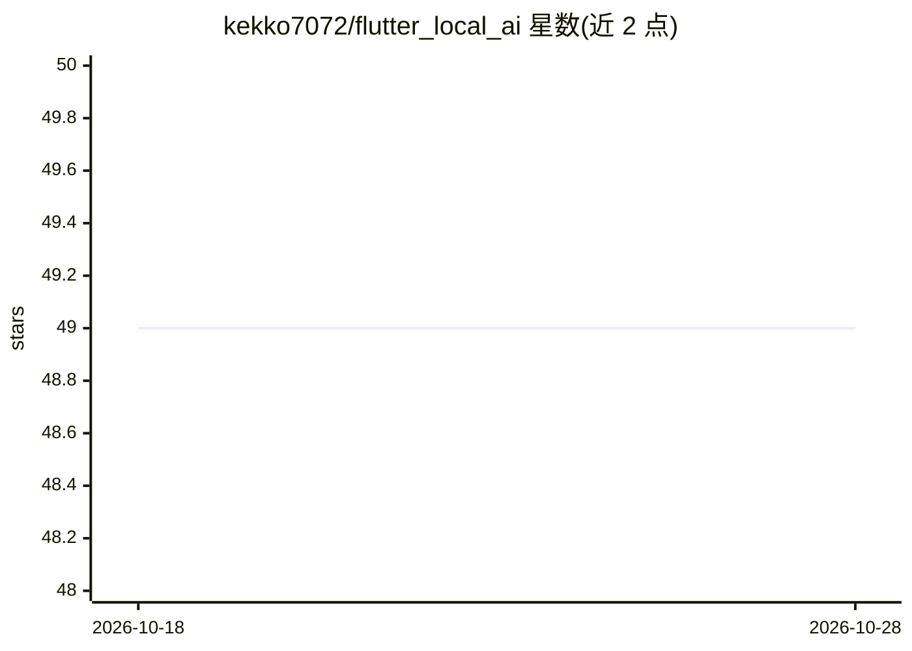

# kekko7072/flutter_local_ai

⭐ 49 · Dart · MIT · 推送 2026-10-27 · [GitHub](https://github.com/kekko7072/flutter_local_ai) · [官网](https://pub.dev/packages/flutter_local_ai) · 个人维护

**Flutter 插件：统一 API 调用 iOS/Android/Windows/Chrome 系统内置端侧 AI 模型**

Flutter/Dart 包，通过各操作系统原生 API 做本地 AI 推理：Apple 平台用 Foundation Models（iOS/macOS 26+）、Android 用 ML Kit GenAI（Gemini Nano）、Windows 用 Windows AI APIs、Web 用 Chrome Prompt API。不打包模型权重，由 OS/浏览器管理下载。支持文本生成、流式、JSON Schema 结构化输出、工具调用与 generative UI。提供两层 API（一次性 facade 与多会话 session 层），各平台能力差异通过 LocalAi.capabilities() 运行时探测；Windows 端在真机上尚未验证，Android 不支持工具调用与结构化输出。

## 筛选速览

| 维度 | 判定 | 备注 |
|---|---|---|
| AI 角色 | `ai-ecosystem` | LLM/agent 周边工具 |
| 许可风险 | `permissive` | MIT |
| 部署形态 | `desktop` | 安装包/桌面程序 |
| 模型依赖 | — | README 未给出锁定关系 |
| 硬件要求 | — | 无带数字的原话,不猜 |
| 安装摩擦 | `medium` | 含编译或系统依赖之一 |
| 成熟度 | — | 结构信号不足 |

## 能力要点

- 零模型打包：直接使用 OS 管理的内置模型（Foundation Models/Gemini Nano/Windows AI/Chrome Prompt API）
- 文本生成、流式输出、JSON Schema 结构化输出、原生工具调用、generative UI
- LocalAi.capabilities()/availability() 运行时探测各平台能力与可用性
- 两层 API：FlutterLocalAi 一次性接口与 LocalAiModel/LocalAiSession 多并发会话接口

## 适用场景

- 在 Flutter 应用中加入端侧文本生成，无需下载或打包模型
- 用 JSON Schema 约束生成结构化数据供应用解析
- 跨 iOS/Android/Windows/Web 用同一套 API 访问系统 AI 能力
- 通过 OS 内置模型实现自然语言驱动的 generative UI

## 场景标签

`推理引擎` · 领域:训练与推理

## 证据(README 行号)

> L5: A Flutter package that provides a unified API for local AI inference on Android with *ML Kit GenAI*, on Apple Platfo
> L15: **This package uses OS-managed models through native APIs, with no app-bundled model checkpoint.**
> L85: adapts this package to flutter_edge_ai's `InferenceEngineProvider`, so an OS

## 星数曲线

2026-10-18 49 → 2026-10-28 49（+0）

---
*卡片 v1 · prompt 1.4 · 生成 2026-10-24 · 置信度 high · 依据 README sha `c2c5c2b5d040` · [字段定义](../../DATASET.md)*
