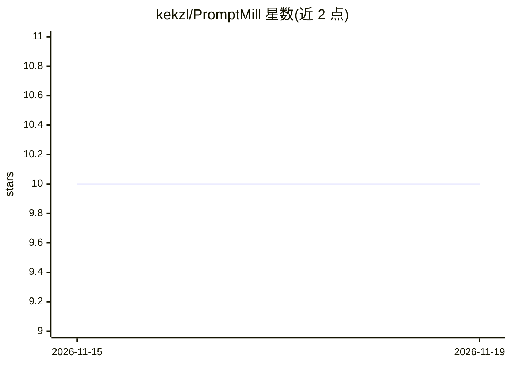

# kekzl/PromptMill

⭐ 10 · Python · 推送 2026-11-10 · [GitHub](https://github.com/kekzl/PromptMill) · 个人维护

**面向创作者的本地化 AI 提示词生成器，覆盖视频/图像/音频/3D**

以 Gradio Web UI 与 REST API 形式运行的自包含提示词生成应用，完全本地运行，无需 API key 与云服务。内置 169 个专用提示词目标（视频 43、图像 40、音频 26、3D 26、创意写作 34），后端使用 1B-24B 参数的 uncensored Dolphin 3.0 GGUF 模型，按检测到的 GPU VRAM 自动选择 8 个档位之一，模型首次使用时自动下载并持久化到卷中。官方提供预构建 Docker 镜像，CPU/GPU 双 profile，无需编译。

## 筛选速览

| 维度 | 判定 | 备注 |
|---|---|---|
| AI 角色 | `ai-native` | 本体是模型或模型工具 |
| 许可风险 | `permissive` | — |
| 部署形态 | `self-host` | docker 或自建部署 |
| 模型依赖 | local-ok | 支持本地模型 |
| 硬件要求 | `cpu-ok` | |
| 安装摩擦 | `low` | 无编译、无系统依赖或容器化 |
| 成熟度 | — | 结构信号不足 |

## 能力要点

- 169 个专用提示词目标，按 5 类组织并支持分类筛选与搜索
- 按 GPU VRAM 自动选择 1B-24B 的 Dolphin 模型档位
- 提供 REST API（含流式生成），交互式文档于 /docs
- 预构建 GHCR 镜像 + start.sh 一键启动，零配置

## 适用场景

- 为 Sora、FLUX、Suno 等生成工具快速产出格式化提示词
- 离线环境下批量生成提示词（通过 REST API 脚本化调用）
- 按本机显存档位运行不同规模的本地 LLM

## 场景标签

`提示工程` · 领域:Agent 开发

## 证据(README 行号)

> L16: PromptMill is a self-contained web UI that runs **entirely locally** - no API keys, no cloud dependencies. It uses 
> L141: |`POST`|`/api/generate`|Generate a prompt, returns JSON|

## 星数曲线

2026-11-15 10 → 2026-11-19 10（+0）

---
*卡片 v1 · prompt 1.4 · 生成 2026-11-19 · 置信度 high · 依据 README sha `3a54b27de37e` · [字段定义](../../DATASET.md)*
