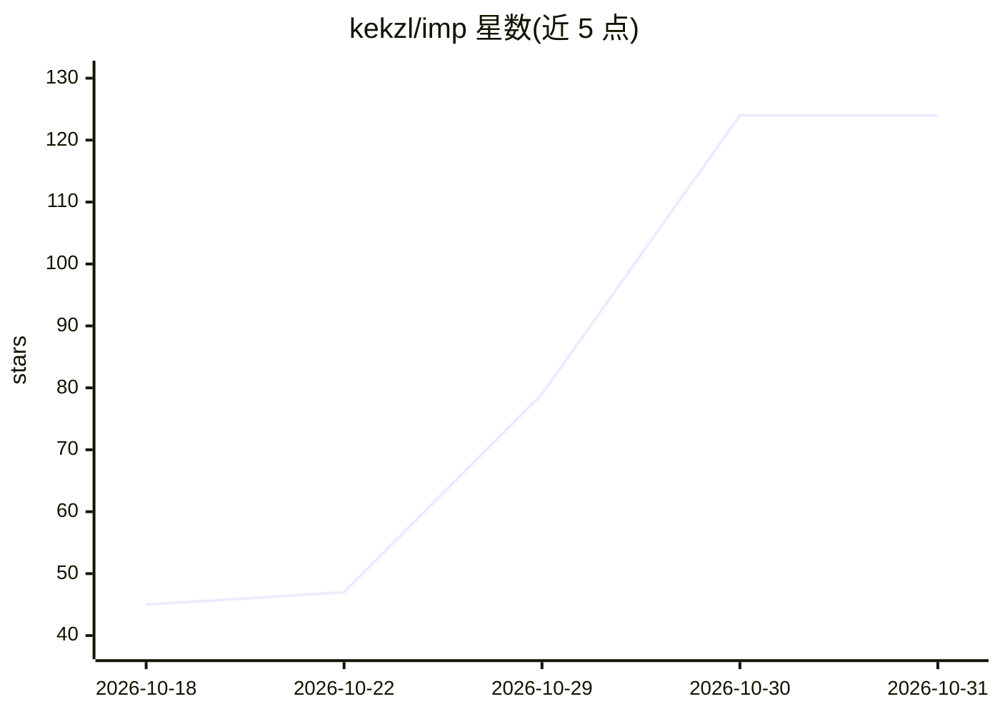

# kekzl/imp

⭐ 124 · C++ · MIT · 推送 2026-10-30 · [GitHub](https://github.com/kekzl/imp) · 个人维护

**面向 NVIDIA Blackwell GPU 的专用 LLM 推理服务器**

C++23 编写的本地推理服务器，仅针对 Blackwell sm_120a 架构（RTX 50 系列、RTX PRO Blackwell）优化：利用原生 FP4 数学、tensor core、CUDA graph 重放、投机解码与连续批处理。支持加载 GGUF 与 NVFP4 SafeTensors 两种格式，MoE 模型的专家权重可驻留主机内存以运行超出显存的模型。对外提供 OpenAI 与 Anthropic 两种 API 及浏览器内置聊天界面，通过 docker run 部署，也提供免 Docker 的 tarball。限制：不支持其他 GPU、CPU、多卡；单一作者维护，issue 回复无保证。

## 筛选速览

| 维度 | 判定 | 备注 |
|---|---|---|
| AI 角色 | `ai-ecosystem` | LLM/agent 周边工具 |
| 许可风险 | `permissive` | MIT |
| 部署形态 | `self-host` | docker 或自建部署 |
| 模型依赖 | — | README 未给出锁定关系 |
| 硬件要求 | — | 无带数字的原话,不猜 |
| 安装摩擦 | `low` | 无编译、无系统依赖或容器化 |
| 成熟度 | — | 结构信号不足 |

## 能力要点

- 专为 Blackwell sm_120a 单一架构编写，直接以 NVFP4 计算
- MoE 专家驻留主机内存，32 GB 显卡可运行 123.6 GiB 模型
- 提供 OpenAI 与 Anthropic 两种 API、工具调用、JSON 输出与内置聊天
- 单容器部署，无需 CUDA toolkit 与 Python 环境

## 适用场景

- 在 RTX 5090 上以单卡本地服务 Qwen 等模型供编程 agent 调用
- 显存不足时用主机内存承载 MoE 专家运行大模型
- 多用户共享单卡的本地推理服务

## 场景标签

`推理引擎` · 领域:训练与推理

## 证据(README 行号)

> L10: General-purpose engines run on every GPU, so none of them is built around yours. imp is written for exactly one chi
> L31: - **Drop-in for your tools.** OpenAI and Anthropic APIs, tool calling, JSON output, streaming, thinking models, a b
> L88: - **Your apps and coding agents:** an "OpenAI-compatible" provider with base URL **`http://localhost:8080/v1`**; An

## 星数曲线

2026-10-18 45 → 2026-10-31 124（+79）

---
*卡片 v1 · prompt 1.4 · 生成 2026-10-25 · 置信度 high · 依据 README sha `1d350b2519d4` · [字段定义](../../DATASET.md)*
