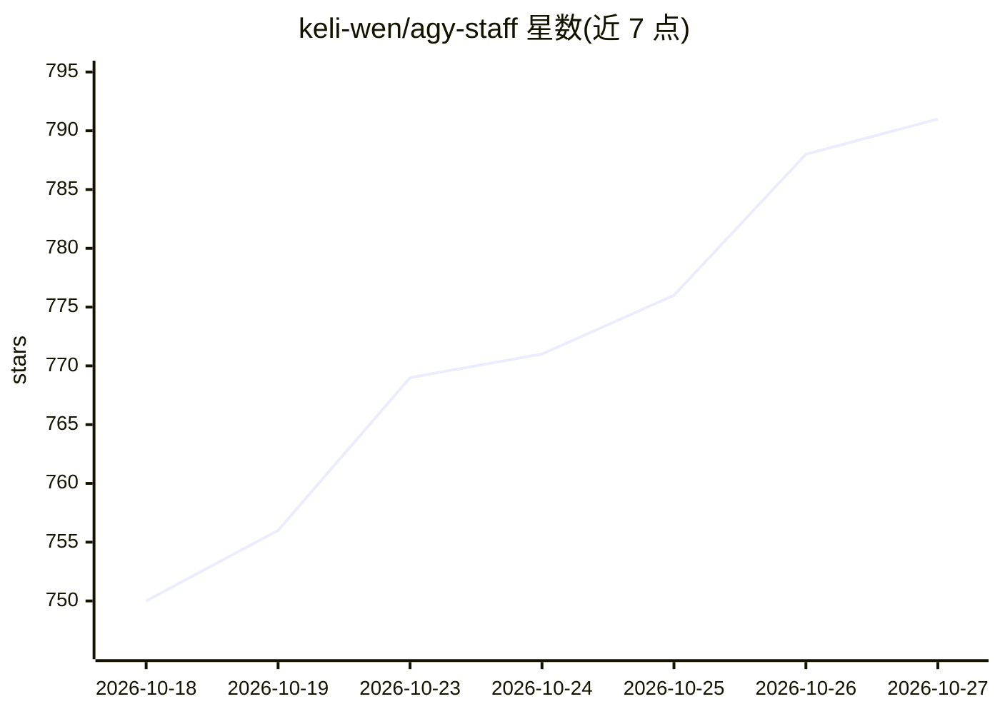

# keli-wen/agy-staff

⭐ 791 · JavaScript · MIT · 推送 2026-10-24 · [GitHub](https://github.com/keli-wen/agy-staff) · 个人维护 · 中文 README

**让 Claude Code/Codex 等编码代理把任务委派给 Antigravity CLI 的插件**

面向 Claude Code、OpenAI Codex、Pi 和 OpenCode 四种编码代理宿主的插件：把 Google Antigravity CLI（agy，Gemini 3.8 Flash）作为可委派的快速 worker 引入宿主代理，提供 staffer/researcher/reviewer/implementer/ask/lead 等角色，通过 /agy:、$agy: 等斜杠命令调用，后台任务以 job id 加 wait/observe/result 机制收集结果。附带 Bench v1，在 SWE-bench Verified 等三个基准上对比宿主单独运行与委派 agy 的开销（单次运行基线）。设计为 bash 加 skills、无宿主硬依赖。默认运行无权限隔离，受限模式为可选加固。

## 筛选速览

| 维度 | 判定 | 备注 |
|---|---|---|
| AI 角色 | `ai-ecosystem` | LLM/agent 周边工具 |
| 许可风险 | `permissive` | MIT |
| 部署形态 | `None` |  |
| 模型依赖 | — | README 未给出锁定关系 |
| 硬件要求 | — | 无带数字的原话,不猜 |
| 安装摩擦 | `low` | 无编译、无系统依赖或容器化 |
| 成熟度 | — | 结构信号不足 |

## 能力要点

- 支持 Claude Code/Codex/Pi/OpenCode 四种宿主的统一安装与调用
- 五种角色覆盖调研、代码与方案评审、范围实现、快速问答
- 后台 job 机制：wait/observe/result/cancel，执行时限默认 60 分钟可至 120 分钟
- Bench v1 在三个基准上对比宿主单独与委派 agy 的 host 开销

## 适用场景

- 我在 Claude Code 里把调研和评审任务交给更快的 agy 处理
- 让第二个模型家族对同一份代码或方案给出第二意见
- 把范围明确的修复任务委派给后台 worker，主代理继续别的工作

## 场景标签

`多智能体` `代码审查` `编码 Agent` · 领域:Agent 开发

## 证据(README 行号)

> L9: Hire Google's Antigravity CLI (`agy`) as a staffer for **Claude Code**, **OpenAI Codex**, **Pi**, and **OpenCode**.
> L17: agy-staff lets your senior agents delegate to `agy`, which ships fast Gemini 3.8 Flash. Five personas: staffer (gen
> L148: `lead` adds task orchestration guidance for your current agent. Within lead, orient enough to frame the assignment

## 星数曲线

2026-10-18 750 → 2026-10-27 791（+41）

---
*卡片 v1 · prompt 1.4 · 生成 2026-10-22 · 置信度 high · 依据 README sha `07685b8c53ba` · [字段定义](../../DATASET.md)*
