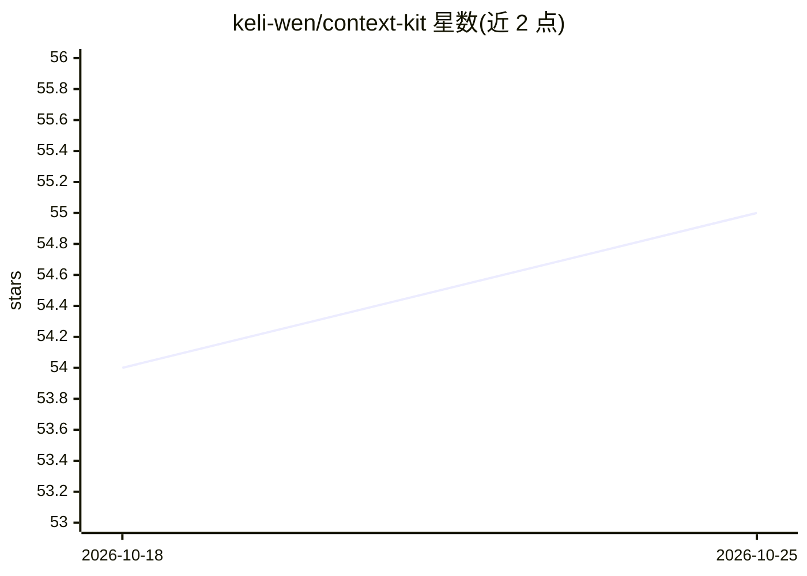

# keli-wen/context-kit

⭐ 55 · Python · MIT · 推送 2026-01-20 · [GitHub](https://github.com/keli-wen/context-kit) · 个人维护 · 中文 README

**给 AI 开发者的极简上下文工程工具库：选择、压缩、持久化上下文**

纯函数组成的 Context Engineering 工具包，非 agent 框架：Context 数据类提供规则式压缩（清除旧工具结果与思考块）与 LLM 摘要压缩，Select 模块提供 list_dir/grep/read_file 的按需检索，Memory 模块按 Claude Memory Tool 接口在上下文窗口外持久化信息，并可导出工具定义给任意 agent 框架（含 CAMEL、Google ADK 集成示例）。LLM 适配器支持 OpenAI/Anthropic/LiteLLM。定位教学与学习，思考块格式支持标注为实验性。

## 筛选速览

| 维度 | 判定 | 备注 |
|---|---|---|
| AI 角色 | `ai-ecosystem` | LLM/agent 周边工具 |
| 许可风险 | `permissive` | MIT |
| 部署形态 | `None` |  |
| 模型依赖 | — | README 未给出锁定关系 |
| 硬件要求 | — | 无带数字的原话,不猜 |
| 安装摩擦 | `low` | 无编译、无系统依赖或容器化 |
| 成熟度 | `idea` | |

## 能力要点

- Context 数据类：规则式压缩与 LLM 摘要压缩、多格式转换（OpenAI/Anthropic/Google）
- Select 模块按需检索（list_dir/grep/read_file），Memory 模块窗口外持久化
- 支持 Anthropic/OpenAI-DeepSeek/Google 三家思考块格式（实验性）
- 导出工具定义，附 CAMEL 与 Google ADK 集成示例

## 适用场景

- 为我的 agent 管理和压缩对话上下文，降低 token 消耗
- 在上下文窗口外持久化 agent 记忆
- 通过可读的极简代码学习 Context Engineering 概念

## 场景标签

`Agent 记忆` · 领域:Agent 开发

## 证据(README 行号)

> L9: A minimal, framework-agnostic toolkit for Context Engineering. Not another agent framework — just pure functions and
> L30: context-kit implements the first three pillars as pure functions, letting you compose them with any agent framework
> L145: Export tool definitions for agent frameworks:

## 星数曲线

2026-10-18 54 → 2026-10-25 55（+1）

---
*卡片 v1 · prompt 1.4 · 生成 2026-10-24 · 置信度 high · 依据 README sha `a33699b8d884` · [字段定义](../../DATASET.md)*
