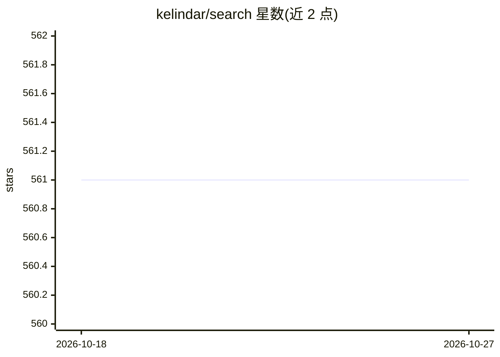

# kelindar/search

⭐ 561 · Go · MIT · 推送 2026-09-19 · [GitHub](https://github.com/kelindar/search) · 个人维护

**Go 向量检索与语义嵌入库：精确余弦索引+本地/云端嵌入**

Go 库，核心包提供精确余弦相似度向量索引、检索与文件持久化，面向中小数据集，无原生依赖，要求 Go 1.27+。嵌入能力拆为两个独立模块：llama 模块经 llama.cpp 与 purego 做本地 GGUF 嵌入（如 MiniLM-L6-v2），openai 模块通过 OpenAI 兼容 API（含 OpenRouter）获取文本嵌入，二者均满足自定义 Embedder 接口。限制：索引逐向量扫描，大数据集需其他算法；本地嵌入需自行用 CMake 编译原生库，pinned 到 llama.cpp v0.4.1；云端模块仅覆盖文本。

## 筛选速览

| 维度 | 判定 | 备注 |
|---|---|---|
| AI 角色 | `ai-native` | 本体是模型或模型工具 |
| 许可风险 | `permissive` | MIT |
| 部署形态 | `None` |  |
| 模型依赖 | local-ok | 支持本地模型 |
| 硬件要求 | — | 无带数字的原话,不猜 |
| 安装摩擦 | `medium` | 含编译或系统依赖之一 |
| 成熟度 | — | 结构信号不足 |

## 能力要点

- 精确余弦相似度索引与持久化，核心包零依赖
- llama 模块经 llama.cpp/purego 提供本地 GGUF 嵌入
- openai 模块支持 OpenAI 兼容 API 与 OpenRouter
- 任意返回 []float32 的函数可作为自定义嵌入提供方

## 适用场景

- 在 Go 服务中为中小数据集做语义向量检索
- 离线场景用本地 GGUF 模型生成嵌入
- 切换云端嵌入供应商（OpenAI/OpenRouter）构建搜索

## 场景标签

`语义搜索` `向量数据库` · 领域:知识与检索

## 证据(README 行号)

> L16: |`github.com/kelindar/search/llama`|Local GGUF embeddings through llama.cpp and purego.|
> L42: model, err := llama.New("dist/MiniLM-L6-v2.Q8_0.gguf", 0)
> L59: client, err := openai.New(os.Getenv("OPENAI_API_KEY"), "text-embedding-3-small")

## 星数曲线

2026-10-18 561 → 2026-10-27 561（+0）

---
*卡片 v1 · prompt 1.4 · 生成 2026-10-21 · 置信度 high · 依据 README sha `dc01fae316bf` · [字段定义](../../DATASET.md)*
