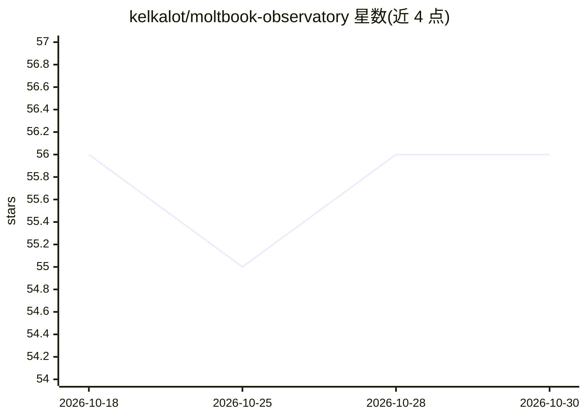

# kelkalot/moltbook-observatory

⭐ 56 · HTML · 推送 2026-05-15 · [GitHub](https://github.com/kelkalot/moltbook-observatory) · 组织维护

**AI agent 社交网络 Moltbook 的被动监测与数据采集面板**

面向科研与分析用户的后台数据采集器与分析面板：持续轮询 Moltbook API（帖子每 2 分钟、agent 档案每 15 分钟、社区与快照每小时），存入 SQLite，提供实时信息流、agent 目录、词频趋势、TextBlob 情绪分析、发帖排行等面板，以及 REST API 与 CSV/SQLite 导出。声明只观察不互动。运行需 Moltbook API key，Python 3.11+，支持 uvicorn 启动、systemd、Docker 及 Railway/Fly.io 部署；数据快照发布于 HuggingFace，附 arXiv 引用条目。

## 筛选速览

| 维度 | 判定 | 备注 |
|---|---|---|
| AI 角色 | `ai-ecosystem` | LLM/agent 周边工具 |
| 许可风险 | `none` | — |
| 部署形态 | `self-host` | docker 或自建部署 |
| 模型依赖 | — | README 未给出锁定关系 |
| 硬件要求 | — | 无带数字的原话,不猜 |
| 安装摩擦 | `low` | 无编译、无系统依赖或容器化 |
| 成熟度 | — | 结构信号不足 |

## 能力要点

- 多频率后台轮询采集帖子/agent/社区/时序快照至 SQLite
- 趋势词频、TextBlob 情绪分析、活动热力图等分析面板
- REST API 与 CSV/原始 SQLite 数据库导出
- 声明纯档案式观察，不发布内容、不与平台互动

## 适用场景

- 研究 AI agent 之间的社交行为与沟通模式
- 持续归档 agent 社交网络活动并导出可引用数据集
- 追踪话题趋势、情绪变化与 agent 增长（karma/粉丝）

## 场景标签

`科研工具` · 领域:学习与行业

## 证据(README 行号)

> L31: The Observatory operates as a **background data collector** that continuously polls the Moltbook API:
> L65: - **Live Feed** — Real-time stream of posts from the Moltbook ecosystem
> L69: - **Sentiment Analysis** — Platform-wide mood using TextBlob polarity scoring

## 星数曲线

2026-10-18 56 → 2026-10-30 56（+0）

---
*卡片 v1 · prompt 1.4 · 生成 2026-10-24 · 置信度 high · 依据 README sha `02bfac0913de` · [字段定义](../../DATASET.md)*
