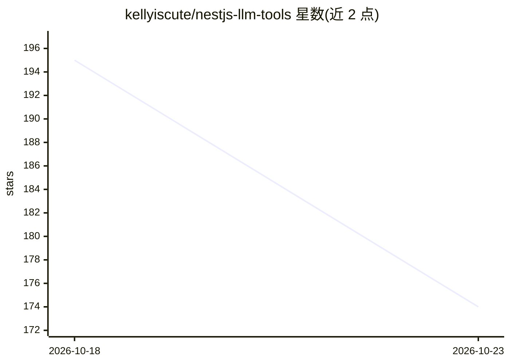

# kellyiscute/nestjs-llm-tools

⭐ 174 · TypeScript · 推送 2026-06-29 · [GitHub](https://github.com/kellyiscute/nestjs-llm-tools) · 个人维护

**用装饰器把 NestJS 方法定义为 LLM 函数调用工具的模块**

一个 NestJS 库，提供 @LlmTool 与 @ToolParam 装饰器，将服务方法标记并注册为结构化的 LLM function calling 工具。启动时自动扫描 providers 与 controllers 发现工具，参数名与原始类型可自动推断，复杂类型需显式 Zod schema。LlmToolsService 支持获取工具定义、输出 OpenAI SDK 格式或 JSON Schema 格式，并可按名称执行工具与按索引注入上下文参数。面向使用 NestJS 构建 LLM 应用（tool calling / agent）的开发者，npm 安装，MIT 许可。

## 筛选速览

| 维度 | 判定 | 备注 |
|---|---|---|
| AI 角色 | `ai-ecosystem` | LLM/agent 周边工具 |
| 许可风险 | `none` | — |
| 部署形态 | `library` | 以包/库形式分发 |
| 模型依赖 | — | README 未给出锁定关系 |
| 硬件要求 | — | 无带数字的原话,不猜 |
| 安装摩擦 | `low` | 无编译、无系统依赖或容器化 |
| 成熟度 | — | 结构信号不足 |

## 能力要点

- @LlmTool/@ToolParam 装饰器声明式定义工具
- 启动时自动发现并注册 providers/controllers 中的工具
- getOpenAiTools 输出 OpenAI SDK 格式，另提供 JSON Schema 参数格式
- callTool 支持按索引位置注入上下文参数

## 适用场景

- 把现有 NestJS 服务方法暴露为 LLM function calling 工具
- 在 OpenAI SDK 集成中获取符合格式的工具定义
- 为 agent 应用统一管理工具注册与执行

## 场景标签

`Agent 框架` · 领域:Agent 开发

## 证据(README 行号)

> L3: A NestJS module that provides decorators and utilities for defining LLM (Large Language Model) function calling tool
> L128: ##### `getOpenAiTools(): ChatCompletionFunctionTool[]`

## 星数曲线

2026-10-18 195 → 2026-10-23 174（-21）

---
*卡片 v1 · prompt 1.4 · 生成 2026-10-23 · 置信度 high · 依据 README sha `f0527f6c548e` · [字段定义](../../DATASET.md)*
