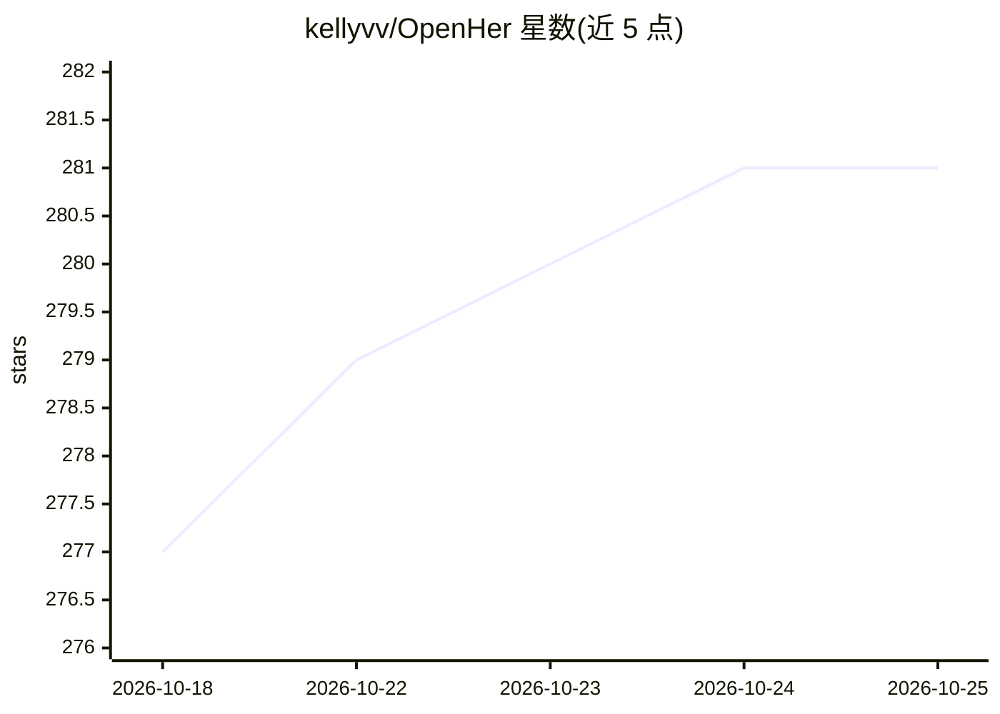

# kellyvv/OpenHer

⭐ 281 · Python · NOASSERTION · 推送 2026-06-27 · [GitHub](https://github.com/kellyvv/OpenHer) · [官网](https://github.com/kellyvv/OpenHer) · 个人维护 · 中文 README

**开源人格引擎：AI 陪伴角色的性格由神经网络涌现而非提示词**

OpenHer 是一个用 Python 编写的人格引擎，灵感来自电影《Her》。它通过随机神经网络（25D→24D→8D）、5 维人格驱力、代谢层与强化学习生成角色性格，配 EverMemOS 跨会话长期记忆与 SQLite 本地事实/风格记忆，支持主动消息、语音/照片等多模态表达与可扩展技能框架。内置 10 个角色，支持 8 家 LLM 服务商及 Ollama 本地模型。提供 macOS SwiftUI 桌面客户端（下载即用）与微信接入方案，角色通过调节驱力参数而非写性格描述来创建。阶段Ⅱ/Ⅲ功能（移动端、生理感知等）在路线图中尚未实现。

## 筛选速览

| 维度 | 判定 | 备注 |
|---|---|---|
| AI 角色 | `ai-native` | 本体是模型或模型工具 |
| 许可风险 | `none` | NOASSERTION |
| 部署形态 | `self-host` | docker 或自建部署 |
| 模型依赖 | local-ok | 支持本地模型 |
| 硬件要求 | — | 无带数字的原话,不猜 |
| 安装摩擦 | `low` | 无编译、无系统依赖或容器化 |
| 成熟度 | — | 结构信号不足 |

## 能力要点

- 人格由神经网络与驱力计算涌现，相同 MBTI 产生不同个体
- 5 维驱力随真实时间代谢，情绪与挫败感动态积累
- EverMemOS 跨会话长期记忆 + SQLite 本地事实/风格记忆
- 8 家 LLM 服务商 + Ollama 本地模型，附四层基准测试报告

## 适用场景

- 与具备长期记忆与情绪变化的 AI 角色持续陪伴聊天
- 通过微信与 AI 角色进行文字、语音、照片交互
- 调节驱力参数创建自定义人格角色

## 场景标签

`聊天机器人` `多模态` · 领域:对话与助手

## 证据(README 行号)

> L54: 每个角色运行在一个活的神经网络之上。性格、情绪和行为从内在驱力中自然涌现，被每一次对话不断塑造。她不只是思考和行动——她会*渴望*、会*感受*、会*记住*、会因为认识你而*成长*。
> L131: OpenHer 以同样的逻辑构建 Persona Engine——**运用仿生机制，创造了一套可人格涌现的神经网络**：
> L143: 每一轮对话不是在执行预设脚本，而是一个**有内部状态的动力学系统**在当前情境、历史记忆与内驱力的共同作用下涌现出的反应。没有任何一行 prompt 描述她的性格——**人格不是被注入的，它在与你的每一次交互中持续生长，直到成为

## 星数曲线

2026-10-18 277 → 2026-10-25 281（+4）

---
*卡片 v1 · prompt 1.4 · 生成 2026-10-22 · 置信度 mid · 依据 README sha `0a5da1226985` · [字段定义](../../DATASET.md)*
