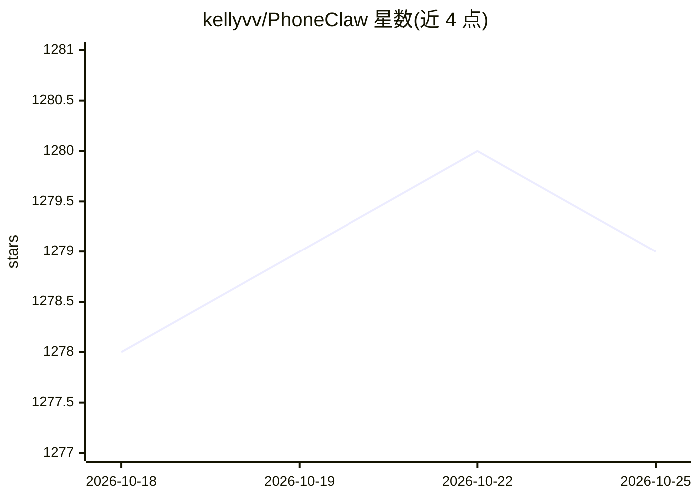

# kellyvv/PhoneClaw

⭐ 1,279 · Swift · Apache-2.0 · 推送 2026-08-06 · [GitHub](https://github.com/kellyvv/PhoneClaw) · [官网](https://kellyvv.github.io/PhoneClaw/) · 个人维护 · 中文 README

**把 iPhone 变成本地 AI agent 运行时的 iOS 应用**

面向 iPhone 用户的本地 AI agent 应用：通过 LiteRT 在设备端运行 Gemma 4 E2B/E4B 与 MiniCPM-V 4.6，用自然语言调用原生 iOS Skills（日历、提醒、通讯录、剪贴板、HealthKit 健康数据、翻译、剪贴板中继），支持 LIVE 实时语音与相机多模态交互，以及灵动岛入口 LiveLand。推理默认全程离线在本机完成；可选经 LAN 配对 Mac Gateway，将请求转发到 Mac 端的 Ollama 或 CLI 模型。技能以单个 SKILL.md 文件定义，可自行编写。分发渠道为 TestFlight 与源码自编译（需 Xcode 16、iOS 17+）。

## 筛选速览

| 维度 | 判定 | 备注 |
|---|---|---|
| AI 角色 | `ai-native` | 本体是模型或模型工具 |
| 许可风险 | `permissive` | Apache-2.0 |
| 部署形态 | `desktop` | 安装包/桌面程序 |
| 模型依赖 | local-ok | 支持本地模型 |
| 硬件要求 | — | 无带数字的原话,不猜 |
| 安装摩擦 | `low` | 无编译、无系统依赖或容器化 |
| 成熟度 | — | 结构信号不足 |

## 能力要点

- 设备端运行 Gemma 4 E2B/E4B（LiteRT）与 MiniCPM-V 4.6 多模态模型
- 原生 iOS Skills：日历/提醒/通讯录/剪贴板/HealthKit/翻译，数据本地处理
- LIVE 实时语音模式（支持相机输入与打断）及灵动岛 LiveLand 入口
- 技能由单个 SKILL.md 文件定义，可自行添加与分享

## 适用场景

- 在 iPhone 上离线用自然语言管理日程、提醒、联系人与健康数据
- 实时语音问答与拍照识物的免手操作交互
- 算力不足时把推理转发到同一局域网内 Mac 上的 Ollama 模型

## 场景标签

`Agent 框架` `语音 Agent` `多模态` · 领域:Agent 开发

## 证据(README 行号)

> L14: PhoneClaw is a local AI agent framework for phones and edge devices. It runs Gemma 4 E2B / E4B via LiteRT and MiniC
> L130: **Private Local Agent**: Run inference and Skill calls directly on device. Use natural language to work with Calen

## 星数曲线

2026-10-18 1,278 → 2026-10-25 1,279（+1）

---
*卡片 v1 · prompt 1.4 · 生成 2026-10-21 · 置信度 mid · 依据 README sha `f45db8ee7d6e` · [字段定义](../../DATASET.md)*
