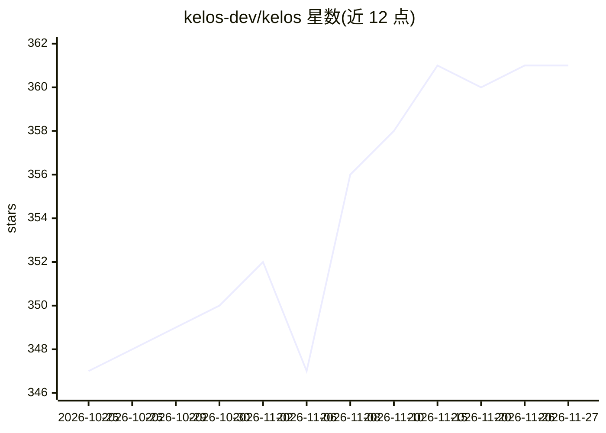

# kelos-dev/kelos

⭐ 361 · Go · Apache-2.0 · 推送 2026-11-26 · [GitHub](https://github.com/kelos-dev/kelos) · 组织维护

**在 Kubernetes 上编排自主 AI 编码代理的工作流框架**

Kelos 是一个 Kubernetes 原生框架，用户以 CRD（Task/Session/Workspace/AgentConfig 等）定义编码代理执行的任务、代码仓库、技能、工具与运行环境，控制器将其转换为 Pods/Jobs/StatefulSets。支持单次任务、持久交互会话、有序流水线与事件触发（GitHub/Jira/Linear/webhook/定时）。提供 CLI、可选 Web Console 与可安装到编码代理内的 /kelos 技能。前置要求为 Kubernetes 1.28+ 集群与 cert-manager。Apache-2.0 许可。

## 筛选速览

| 维度 | 判定 | 备注 |
|---|---|---|
| AI 角色 | `ai-ecosystem` | LLM/agent 周边工具 |
| 许可风险 | `permissive` | Apache-2.0 |
| 部署形态 | `library` | 以包/库形式分发 |
| 模型依赖 | — | README 未给出锁定关系 |
| 硬件要求 | — | 无带数字的原话,不猜 |
| 安装摩擦 | `low` | 无编译、无系统依赖或容器化 |
| 成熟度 | — | 结构信号不足 |

## 能力要点

- 以 Kubernetes CRD 定义代理任务、会话、工作区与代理配置
- 支持 Claude Code、OpenAI Codex、Google Gemini、OpenCode、Cursor 及自定义代理镜像
- 事件驱动触发：GitHub、Jira、Linear、cron、webhook
- 提供 /kelos 代理技能与可选浏览器 Console

## 适用场景

- 用事件触发的方式把 GitHub issue 自动转为代理修复任务并开 PR
- 编排实现、评审、测试、交付的多阶段代理流水线
- 从终端或浏览器重连长时间运行的交互式代理会话

## 场景标签

`工作流自动化` `编码 Agent` `Agent 框架` · 领域:Agent 开发

## 证据(README 行号)

> L3:  Define and run coding-agent workflows on Kubernetes.
> L17: Kelos lets you define what coding agents do and the environments they run in:
> L248: Kubernetes runtime settings. The controller turns Kelos resources into Pods,

## 星数曲线

2026-10-25 347 → 2026-11-27 361（+14）

---
*卡片 v1 · prompt 1.4 · 生成 2026-11-25 · 置信度 high · 依据 README sha `f58e1a26f703` · [字段定义](../../DATASET.md)*
