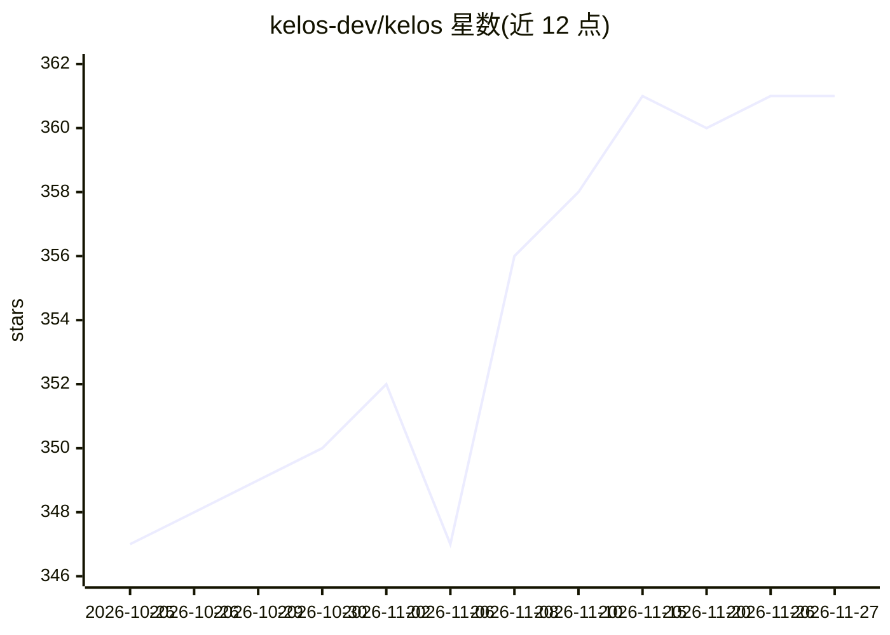

# kelos-dev/kelos

⭐ 361 · Go · Apache-2.0 · 推送 2026-11-26 · [GitHub](https://github.com/kelos-dev/kelos) · 组织维护

**在 Kubernetes 上定义并运行自主 AI 编码 agent 工作流的框架**

Kelos 以 Kubernetes 资源（Task、Session、Workspace、AgentConfig、TaskSpawner 等）定义编码 agent 的工作内容与运行环境，控制器将其转换为 Pods、Jobs、StatefulSets。支持 Claude Code、OpenAI Codex、Google Gemini、OpenCode、Cursor 及自定义 agent 镜像；可触发 GitHub、Jira、Linear、cron 与 webhook 事件，Task 状态记录分支、提交、PR 与 token 用量。需 Kubernetes 1.28+ 集群与 cert-manager，提供 CLI、Helm chart 与可选 Console Web 界面。

## 筛选速览

| 维度 | 判定 | 备注 |
|---|---|---|
| AI 角色 | `ai-ecosystem` | LLM/agent 周边工具 |
| 许可风险 | `permissive` | Apache-2.0 |
| 部署形态 | `library` | 以包/库形式分发 |
| 模型依赖 | locked-api |  |
| 硬件要求 | — | 无带数字的原话,不猜 |
| 安装摩擦 | `low` | 无编译、无系统依赖或容器化 |
| 成熟度 | — | 结构信号不足 |

## 能力要点

- 以 K8s 自定义资源定义 agent 工作流，控制器转换为 Pods/Jobs/StatefulSets
- 支持 Claude Code、Codex、Gemini、OpenCode、Cursor 及自定义 agent 镜像
- TaskSpawner/SessionSpawner 从 GitHub、Jira、Linear、cron、webhook 事件创建任务
- 提供 /kelos agent 技能，通过自然语言配置与操作资源

## 适用场景

- 把 issue 修复、PR 评审等任务交给自主编码 agent 处理
- 在集群上保持可从终端或浏览器重连的持久 agent 会话
- 编排实现、评审、测试、交付的多阶段 agent 流水线
- 跨多个仓库批量执行相同变更

## 场景标签

`编码 Agent` `Agent 框架` · 领域:Agent 开发

## 证据(README 行号)

> L3:  Define and run coding-agent workflows on Kubernetes.
> L248: Kubernetes runtime settings. The controller turns Kelos resources into Pods,

## 星数曲线

2026-10-25 347 → 2026-11-27 361（+14）

---
*卡片 v1 · prompt 1.4 · 生成 2026-11-27 · 置信度 high · 依据 README sha `959c1fbf8f70` · [字段定义](../../DATASET.md)*
