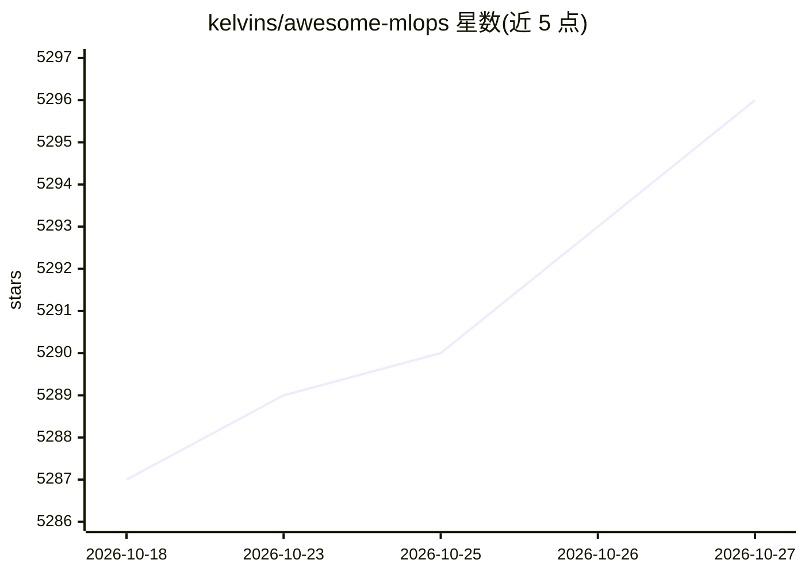

# kelvins/awesome-mlops

⭐ 5,296 · Python · 推送 2026-08-17 · [GitHub](https://github.com/kelvins/awesome-mlops) · 个人维护

**MLOps 工具策展清单：按类别收录机器学习工程工具**

受 awesome-python 启发的 MLOps 工具聚合清单，按 AutoML、CI/CD、数据目录、数据处理、特征工程、特征存储、超参调优、漂移检测、机器学习平台等约 20 个类别组织条目，每条为一句话简介与项目链接。覆盖从数据管理到模型部署监控的机器学习生命周期各环节工具，供工程师选型与发现工具使用。清单本身不含可安装的软件。

## 筛选速览

| 维度 | 判定 | 备注 |
|---|---|---|
| AI 角色 | `ai-knowledge` | 知识聚合/清单类 |
| 许可风险 | `none` | — |
| 部署形态 | `None` |  |
| 模型依赖 | — | README 未给出锁定关系 |
| 硬件要求 | — | 无带数字的原话,不猜 |
| 安装摩擦 | `low` | 无编译、无系统依赖或容器化 |
| 成熟度 | — | 结构信号不足 |

## 能力要点

- 按约 20 个 MLOps 环节类别组织工具条目
- 覆盖 AutoML、特征存储、漂移检测、ML 平台等生命周期环节
- 每条目附一句话简介，便于快速筛选

## 适用场景

- 搭建机器学习流水线时按环节查找候选工具
- 了解 MLOps 各环节的开源/商业工具分布
- 为团队选型数据管理、特征存储或监控方案时做初步调研

## 场景标签

`精选清单` · 领域:学习与行业

## 证据(README 行号)

> L3: A curated list of awesome MLOps tools.
> L9: ## AutoML

## 星数曲线

2026-10-18 5,287 → 2026-10-27 5,296（+9）

---
*卡片 v1 · prompt 1.4 · 生成 2026-10-20 · 置信度 high · 依据 README sha `357494888256` · [字段定义](../../DATASET.md)*
