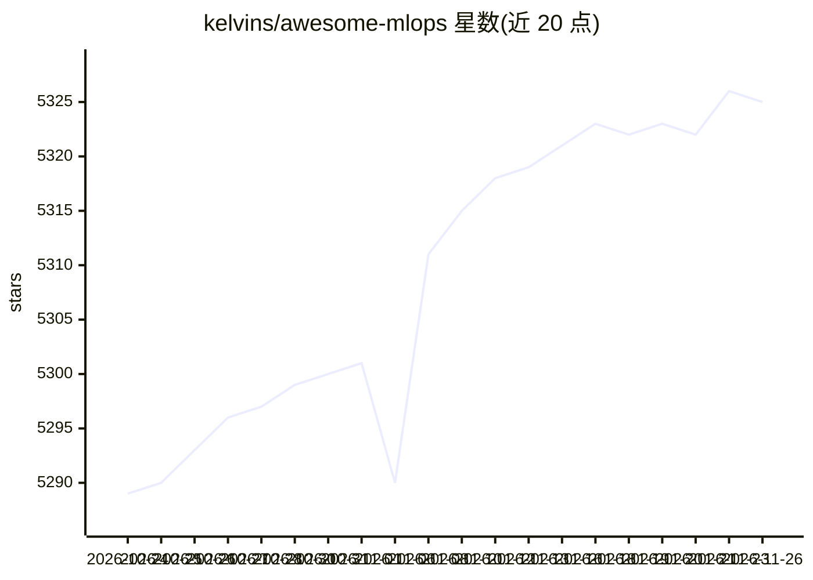

# kelvins/awesome-mlops

⭐ 5,325 · Python · 推送 2026-10-30 · [GitHub](https://github.com/kelvins/awesome-mlops) · 个人维护

**面向 ML 工程师的 MLOps 工具策展清单，按类别组织**

受 awesome-python 启发的 MLOps 工具清单，将机器学习运维领域的工具按 AutoML、CI/CD、数据目录、数据管理、数据验证、可视化、漂移检测、特征工程、特征存储、超参调优、ML 平台等类别组织，每个条目附一句来源描述。README 本身不包含安装步骤或使用文档，仅提供分类索引与链接，内容持续更新，读者需自行访问各工具仓库获取详情。

## 筛选速览

| 维度 | 判定 | 备注 |
|---|---|---|
| AI 角色 | `ai-knowledge` | 知识聚合/清单类 |
| 许可风险 | `none` | — |
| 部署形态 | `None` |  |
| 模型依赖 | — | README 未给出锁定关系 |
| 硬件要求 | — | 无带数字的原话,不猜 |
| 安装摩擦 | `low` | 无编译、无系统依赖或容器化 |
| 成熟度 | — | 结构信号不足 |

## 能力要点

- 按 AutoML、CI/CD、特征存储、ML 平台等多个 MLOps 类别组织条目
- 收录 AutoML、超参调优、漂移检测等专项工具分类
- 数据管理类覆盖 DVC、Delta Lake、向量检索引擎等条目

## 适用场景

- 搭建机器学习流水线时查找各环节对应的工具
- 了解 MLOps 生态中某类工具（如特征存储）有哪些选项
- 为团队选型数据版本管理与实验追踪工具做调研

## 场景标签

`精选清单` `MLOps` · 领域:学习与行业

## 证据(README 行号)

> L3: A curated list of awesome MLOps tools.
> L9: ## AutoML

## 星数曲线

2026-10-24 5,289 → 2026-11-26 5,325（+36）

---
*卡片 v1 · prompt 1.4 · 生成 2026-11-22 · 置信度 high · 依据 README sha `d40a12a078fa` · [字段定义](../../DATASET.md)*
