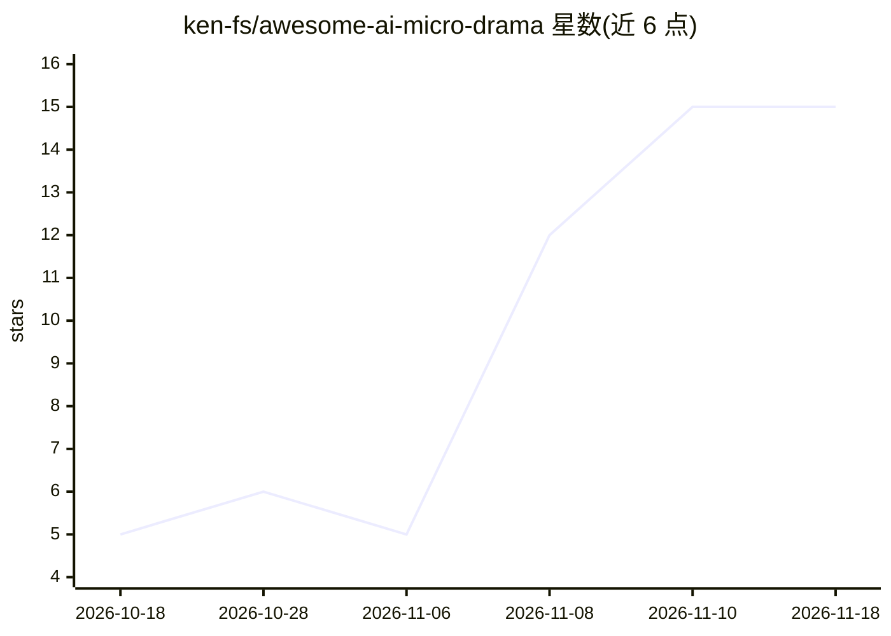

# ken-fs/awesome-ai-micro-drama

⭐ 15 · 推送 2026-10-04 · [GitHub](https://github.com/ken-fs/awesome-ai-micro-drama) · [官网](https://openmicrodrama.com) · 个人维护 · 中文 README

**AI 竖屏短剧制作的开源工具、agent 技能与提示词策展清单**

按功能类别组织的 awesome 清单，收录制作 AI 短剧（竖屏、连载短剧）的开源工具：一体化平台、面向 Claude Code/Codex/Cursor 等 coding agent 的技能包、剧本与小说转脚本工具、分镜与角色一致性工具、Seedance/Kling/Veo 等视频模型提示词库、ComfyUI 工作流。每个条目附简介、GitHub 星数与许可标注（⚠️ 表示非商业或自定义许可）。清单本身注明许多被收录项目仅有中文 README，其描述为编者撰写。

## 筛选速览

| 维度 | 判定 | 备注 |
|---|---|---|
| AI 角色 | `ai-knowledge` | 知识聚合/清单类 |
| 许可风险 | `none` | — |
| 部署形态 | `None` |  |
| 模型依赖 | — | README 未给出锁定关系 |
| 硬件要求 | — | 无带数字的原话,不猜 |
| 安装摩擦 | `medium` | 含编译或系统依赖之一 |
| 成熟度 | — | 结构信号不足 |

## 能力要点

- 按 6 个功能类别组织：一体化平台/agent 技能/剧本/分镜/提示词/ComfyUI 工作流
- 每个条目带许可标注，⚠️ 标记非商业、source-available 或自定义许可
- 覆盖 Seedance、Kling、Veo、Hailuo、Wan、MiniMax H3 等视频模型相关工具

## 适用场景

- 寻找从小说或剧本生成短剧成片的开源工具
- 为 coding agent 查找短剧制作相关的技能包
- 查找特定视频模型的提示词模板与 ComfyUI 工作流

## 场景标签

`精选清单` `视频生成` · 领域:内容生成

## 证据(README 行号)

> L3: > Open-source tools for making AI micro dramas (vertical, serialized short dramas), sorted by what they do. Every en
> L5: Many of the best projects have Chinese-only READMEs. The one-line descriptions here are ours. Licenses vary a lot: a
> L7: ## Contents

## 星数曲线

2026-10-18 5 → 2026-11-18 15（+10）

---
*卡片 v1 · prompt 1.4 · 生成 2026-11-18 · 置信度 high · 依据 README sha `70641be2d783` · [字段定义](../../DATASET.md)*
