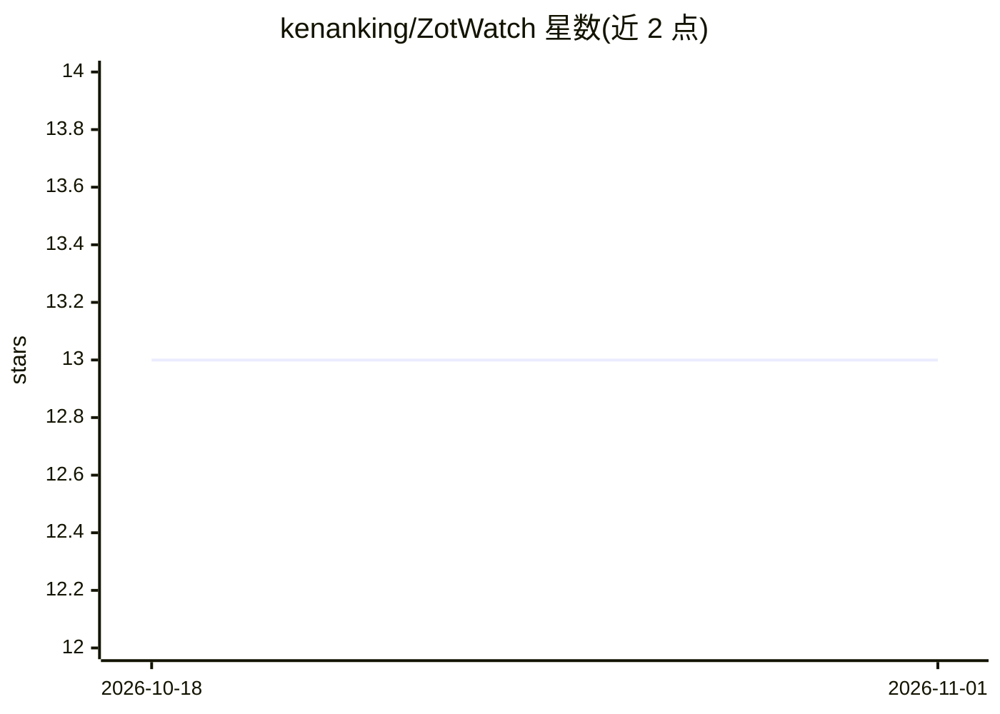

# kenanking/ZotWatch

⭐ 13 · Python · MIT · 推送 2026-05-25 · [GitHub](https://github.com/kenanking/ZotWatch) · [官网](https://ehehe.cn/zotwatch/) · 个人维护 · 中文 README

**基于 Zotero 文库的个人文献推荐与监测系统**

面向 Zotero 用户的智能文献推荐工具：通过 Zotero Web API 同步文库并构建研究兴趣画像（Voyage AI 或 DashScope 嵌入，支持增量计算），从 Crossref、arXiv 抓取候选论文，结合语义相似度、时间衰减、引用指标、期刊白名单评分排序，并可用 Voyage Rerank 按兴趣描述重排序。LLM 部分用 Kimi（Moonshot AI）或 OpenRouter 生成 AI 摘要、翻译标题、分析研究画像。输出 RSS 与响应式 HTML 报告，可本地运行或经 GitHub Actions 每日自动执行；摘要抓取依赖 Camoufox 反检测浏览器（约 200MB）。

## 筛选速览

| 维度 | 判定 | 备注 |
|---|---|---|
| AI 角色 | `ai-native` | 本体是模型或模型工具 |
| 许可风险 | `permissive` | MIT |
| 部署形态 | `None` |  |
| 模型依赖 | locked-api |  |
| 硬件要求 | — | 无带数字的原话,不猜 |
| 安装摩擦 | `low` | 无编译、无系统依赖或容器化 |
| 成熟度 | — | 结构信号不足 |

## 能力要点

- 增量嵌入计算，仅处理新增/变更的 Zotero 条目
- 多源抓取（Crossref/arXiv）+ 语义相似度、时间衰减、期刊白名单评分
- 支持 Voyage AI/DashScope 嵌入与 Kimi/OpenRouter LLM 双提供商切换
- RSS + HTML 报告输出，支持 GitHub Actions 每日自动运行

## 适用场景

- 根据我的 Zotero 文库自动发现相关新论文
- 通过 RSS 或 HTML 报告每日查看个性化文献推荐
- 为推荐论文自动生成中文摘要并翻译英文标题

## 场景标签

`科研工具` · 领域:学习与行业

## 证据(README 行号)

> L3: ZotWatch 是一个基于 Zotero 文库构建个人研究兴趣画像，并持续监测学术信息源的智能文献推荐系统。支持 AI 摘要生成、增量嵌入计算，可在本地手动执行或通过 GitHub Actions 自动运行。
> L18: - **兴趣驱动推荐**：基于用户描述的研究兴趣，使用 Voyage Rerank 进行语义重排序
> L19: - **AI 摘要生成**：支持 Kimi (Moonshot AI) 和 OpenRouter (Claude 等) 两种 LLM 提供商

## 星数曲线

2026-10-18 13 → 2026-11-01 13（+0）

---
*卡片 v1 · prompt 1.4 · 生成 2026-10-31 · 置信度 high · 依据 README sha `f97919bb366d` · [字段定义](../../DATASET.md)*
