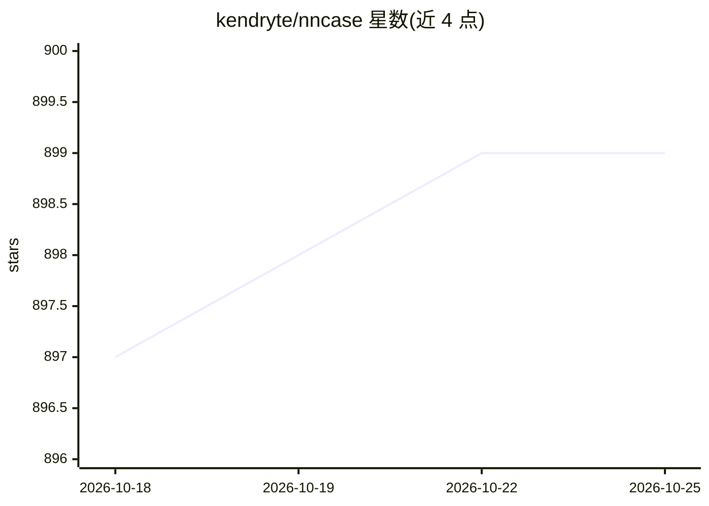

# kendryte/nncase

⭐ 899 · C# · Apache-2.0 · 推送 2026-07-17 · [GitHub](https://github.com/kendryte/nncase) · 组织维护 · 中文 README

**面向 Kendryte AI 加速器的神经网络编译器，供 K210/K510/K230 部署模型**

面向 Kendryte（嘉楠）K210/K510/K230 AI 加速器芯片的神经网络编译器栈：读取 TFLite/Caffe/ONNX 模型，经算子融合、量化（float 与 uint8、校准数据后量化）、静态内存分配与零拷贝加载生成可在加速器上运行的模型，并给出 benchmark 精度与帧率数据。面向在这些芯片上部署深度学习模型的嵌入式开发者。推荐以 pip 安装，K510/K230 相关源码未开源，无法从源码编译对应版本；提供 QQ 群与 Telegram 社区。

## 筛选速览

| 维度 | 判定 | 备注 |
|---|---|---|
| AI 角色 | `ai-ecosystem` | LLM/agent 周边工具 |
| 许可风险 | `permissive` | Apache-2.0 |
| 部署形态 | `library` | 以包/库形式分发 |
| 模型依赖 | — | README 未给出锁定关系 |
| 硬件要求 | — | 无带数字的原话,不猜 |
| 安装摩擦 | `low` | 无编译、无系统依赖或容器化 |
| 成熟度 | — | 结构信号不足 |

## 能力要点

- 支持 TFLite/Caffe/ONNX 模型导入编译
- 算子融合、uint8 量化与校准数据后量化
- 静态内存分配与零拷贝模型加载
- 提供分类/检测/分割/姿态模型的 benchmark 数据

## 适用场景

- 把训练好的神经网络模型部署到 K210/K510/K230 开发板
- 将 float 模型量化为 uint8 以在边缘芯片上推理
- 查询常见模型在 Kendryte 芯片上的帧率与精度数据

## 场景标签

`模型量化` `推理引擎` · 领域:训练与推理

## 证据(README 行号)

> L7: `nncase` is a neural network compiler for AI accelerators.
> L99: **It is recommended to install nncase directly through `pip`. At present, the source code related to k510 and K230 

## 星数曲线

2026-10-18 897 → 2026-10-25 899（+2）

---
*卡片 v1 · prompt 1.4 · 生成 2026-10-21 · 置信度 high · 依据 README sha `1c2a8e6f99d1` · [字段定义](../../DATASET.md)*
