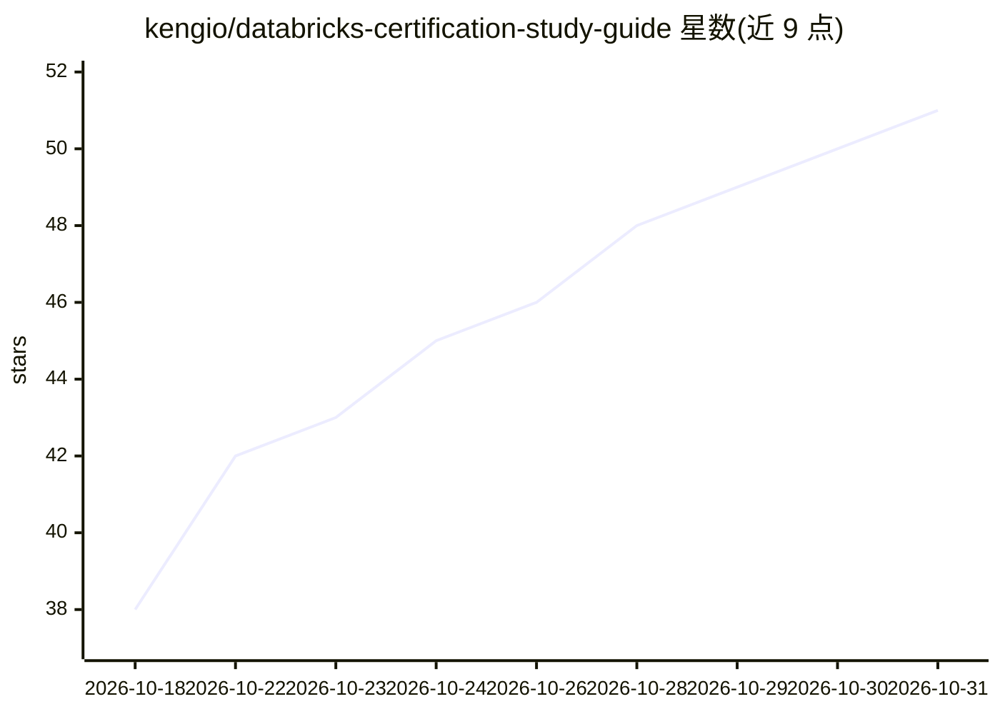

# kengio/databricks-certification-study-guide

⭐ 51 · JavaScript · MIT · 推送 2026-10-26 · [GitHub](https://github.com/kengio/databricks-certification-study-guide) · 个人维护

**Databricks 六项认证的开源社区备考指南（笔记+题库）**

社区维护的 Databricks 认证学习指南，覆盖数据工程师 Associate/Professional、数据分析师 Associate、ML Associate/Professional、GenAI 工程师 Associate 共六项认证，内容与 2025-2026 官方考试大纲对齐。提供速查表、练习题、模拟考试与端到端示例，各认证章节列出官方域权重、时长、题量与语言。附浏览器内运行的自适应练习测验（931 题跨 18 个题库，本地保存进度，无需安装注册）。内容以 Obsidian 兼容 Markdown 编写，也可在 GitHub/VS Code 阅读，接受 PR。

## 筛选速览

| 维度 | 判定 | 备注 |
|---|---|---|
| AI 角色 | `ai-knowledge` | 知识聚合/清单类 |
| 许可风险 | `permissive` | MIT |
| 部署形态 | `None` |  |
| 模型依赖 | — | README 未给出锁定关系 |
| 硬件要求 | — | 无带数字的原话,不猜 |
| 安装摩擦 | `low` | 无编译、无系统依赖或容器化 |
| 成熟度 | — | 结构信号不足 |

## 能力要点

- 覆盖全部六项 Databricks 认证并与官方考试大纲逐项映射
- 浏览器内自适应练习测验：931 题跨 18 个题库（6 练习+12 模拟），含计时器与弱项分析
- 各认证给出域权重、时长、题量、语言等考试细节表
- Obsidian 优化：callouts、可折叠答案、Mermaid 图、Graph View

## 适用场景

- 备考 Databricks 数据工程师/分析师/ML/GenAI 任一认证
- 系统梳理 Delta Lake、Unity Catalog、Lakeflow、MLflow 等平台知识
- 用内置题库做模拟考试并追踪薄弱模块

## 场景标签

`教程课程` · 领域:学习与行业

## 证据(README 行号)

> L19:  Databricks Certification Study Guide
> L36:  A community-maintained study guide covering every active Databricks certification.
> L40: > **These are the exam notes I built while preparing for the Databricks certification series.** Cheat sheets, pract

## 星数曲线

2026-10-18 38 → 2026-10-31 51（+13）

---
*卡片 v1 · prompt 1.4 · 生成 2026-10-25 · 置信度 high · 依据 README sha `7a3f7799d396` · [字段定义](../../DATASET.md)*
