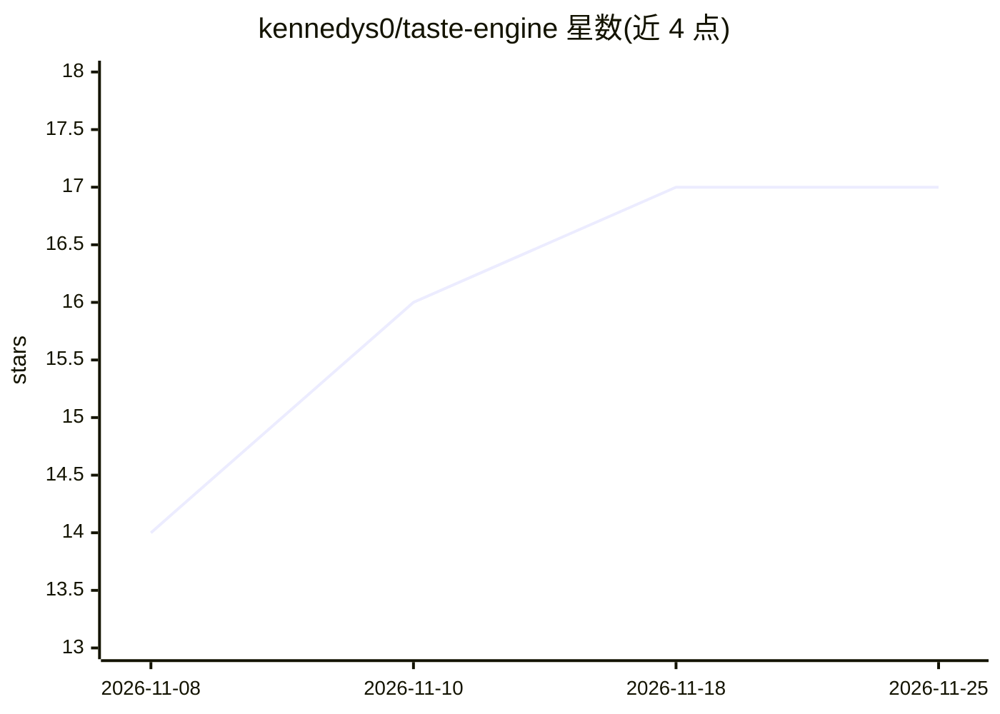

# kennedys0/taste-engine

⭐ 17 · CSS · MIT · 推送 2026-11-14 · [GitHub](https://github.com/kennedys0/taste-engine) · [官网](https://kennedys0.github.io/taste-engine/) · 个人维护

**给 AI agent 的前端设计技能包：按用户选定的视觉风格生成界面**

可移植的开源 Agent Skill（SKILL.md 包），用于辅助 AI agent 构建界面：先询问用户偏好的视觉风格，再加载对应风格包、实现并审查。内置 10 种风格原型（Claymorphism、Frutiger Aero、Brutalism、Y2K Futurism 等）及变体，每种提供 CSS 参考配方与截图级 Material Fidelity Gate 质量检查，另含 SEO 指引、动效规范、Tailwind CSS 预设与 shadcn/ui 主题变量覆盖。通过 npx skills CLI 或自带 Node.js 安装器装到 Claude Code、Cursor、Copilot 等 agent/IDE；README 注明安装命令在源文件发布后才可用。

## 筛选速览

| 维度 | 判定 | 备注 |
|---|---|---|
| AI 角色 | `ai-ecosystem` | LLM/agent 周边工具 |
| 许可风险 | `permissive` | MIT |
| 部署形态 | `library` | 以包/库形式分发 |
| 模型依赖 | — | README 未给出锁定关系 |
| 硬件要求 | — | 无带数字的原话,不猜 |
| 安装摩擦 | `low` | 无编译、无系统依赖或容器化 |
| 成熟度 | `idea` | |

## 能力要点

- 10 种风格原型及布局/表达变体，各带 CSS 参考配方
- 工作流：先问风格再写 UI 代码，含 Material Fidelity Gate 审查
- Tailwind CSS 预设与 shadcn/ui 主题变量覆盖
- 自带 CLI 支持安装、更新、dry-run 与旧目录备份

## 适用场景

- 让 coding agent 生成界面前先确认我的视觉风格偏好
- 按 Claymorphism、Y2K 等具体风格获得带质量门的实现
- 在多个 agent/IDE（Claude Code、Cursor 等）间复用同一设计技能

## 场景标签

`提示工程` · 领域:Agent 开发

## 证据(README 行号)

> L5: A portable, open-source Agent Skill for building distinctive, accessible frontends with user-selected visual styles,
> L57: Requires Node.js and access to GitHub. The repository exposes a standard `skills/taste-engine/SKILL.md` package, so

## 星数曲线

2026-11-08 14 → 2026-11-25 17（+3）

---
*卡片 v1 · prompt 1.4 · 生成 2026-11-18 · 置信度 high · 依据 README sha `7107ee7c3dd0` · [字段定义](../../DATASET.md)*
