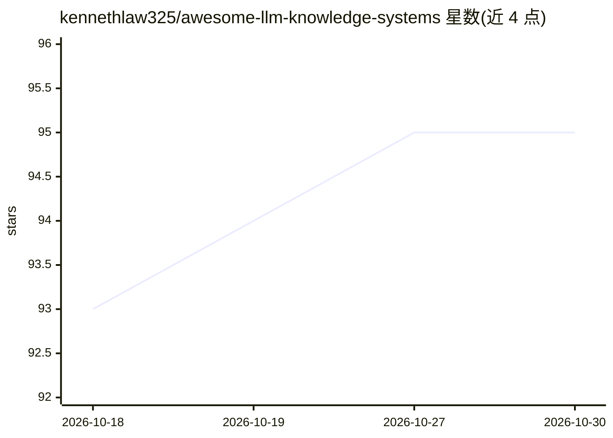

# kennethlaw325/awesome-llm-knowledge-systems

⭐ 95 · HTML · MIT · 推送 2026-09-15 · [GitHub](https://github.com/kennethlaw325/awesome-llm-knowledge-systems) · 个人维护 · 中文 README

**LLM 知识工程统一知识地图：串联 RAG、记忆、技能系统与 MCP 等概念**

一份以知识地图形式编写的 LLM 知识工程指南（awesome-list 类），自述分析了 50+ 清单与综述后，将 RAG、Context/Harness Engineering、Skill Systems、Agent Memory、MCP、Progressive Disclosure 等分散领域串联为带编号章节的统一框架。正文按时间线追踪 2026 年行业事件（模型发布、安全产品、记忆研究、治理动态），条目均注明章节与出处指针，且对厂商声明与未复现数字做来源标注。提供英/中/日/韩/西多语言版本。面向从事 LLM 应用与 agent 工程的开发者和研究者作概念导航用。

## 筛选速览

| 维度 | 判定 | 备注 |
|---|---|---|
| AI 角色 | `ai-knowledge` | 知识聚合/清单类 |
| 许可风险 | `permissive` | MIT |
| 部署形态 | `None` |  |
| 模型依赖 | — | README 未给出锁定关系 |
| 硬件要求 | — | 无带数字的原话,不猜 |
| 安装摩擦 | `low` | 无编译、无系统依赖或容器化 |
| 成熟度 | — | 结构信号不足 |

## 能力要点

- 串联 RAG、Context/Harness Engineering、Skill Systems、Agent Memory、MCP 等领域的统一章节结构
- 按时间波次追踪 2026 年模型、安全、记忆与治理动态并给出章节引用
- 对厂商自报数字与未复现结果逐条标注来源性质
- 提供 6 种语言的 README 版本

## 适用场景

- 查领域术语与概念在整体知识工程版图中的位置
- 按时间线了解 2026 年 agent/记忆/安全生态的事件与出处
- 作为进入各子领域（记忆、技能、MCP、harness）的索引入口

## 场景标签

`精选清单` · 领域:学习与行业

## 证据(README 行号)

> L5: > I analyzed 50+ awesome lists, surveys, and guides -- none of them connected the dots. RAG papers don't mention har
> L9: The mid-September 2026 wave adds ten timeline entries — nine external plus this guide's own survival-gate result — a

## 星数曲线

2026-10-18 93 → 2026-10-30 95（+2）

---
*卡片 v1 · prompt 1.4 · 生成 2026-10-23 · 置信度 high · 依据 README sha `070b7f4e3427` · [字段定义](../../DATASET.md)*
