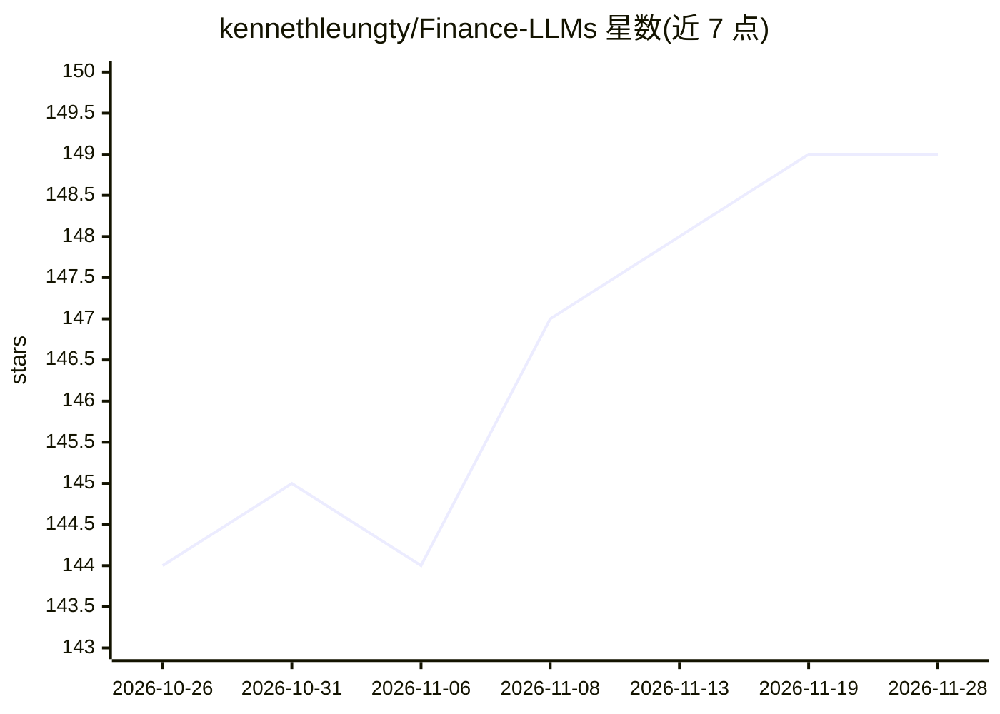

# kennethleungty/Finance-LLMs

⭐ 149 · MIT · 推送 2026-11-26 · [GitHub](https://github.com/kennethleungty/Finance-LLMs) · [官网](https://medium.com/datadriveninvestor/how-llms-are-reshaping-financial-services-real-world-examples-d07bc74ad4bd) · 个人维护

**金融服务业 LLM 与 AI Agent 落地案例清单**

按银行、财富与资管、资本市场、支付、保险、研究/开源模型六个板块组织，收录全球金融机构实际部署的 LLM 与 Agent 应用案例；每个条目按 Enterprise Platform、Fine-Tuned Model、Integrated Solution 三类标注，表格字段包含名称、类型、日期、描述、站点与论文链接，并欢迎通过 pull request / issue 提交新案例。仓库本体为索引型清单，不含可安装运行的自有代码。

## 筛选速览

| 维度 | 判定 | 备注 |
|---|---|---|
| AI 角色 | `ai-knowledge` | 知识聚合/清单类 |
| 许可风险 | `permissive` | MIT |
| 部署形态 | `None` |  |
| 模型依赖 | — | README 未给出锁定关系 |
| 硬件要求 | — | 无带数字的原话,不猜 |
| 安装摩擦 | `medium` | 含编译或系统依赖之一 |
| 成熟度 | — | 结构信号不足 |

## 能力要点

- 按银行、财富资管、资本市场、支付、保险等金融子领域分类组织条目
- 每个案例标注 Enterprise Platform / Fine-Tuned Model / Integrated Solution 三类
- 条目附站点与论文链接字段
- 收录未商业部署的开源金融模型（如 FinGPT、FinMA、InvestLM）专设板块

## 适用场景

- 调研金融行业真实的 LLM/Agent 部署案例与效果指标
- 为金融 AI 采购或方案设计寻找同类先例
- 查找金融领域开源模型与 agent 框架线索

## 场景标签

`精选清单` · 领域:学习与行业

## 证据(README 行号)

> L3:  Compilation of Real-World LLM & AI Agent Use Cases in Financial Services
> L8: This repository curates real-world LLM and agentic AI implementations in finance, showcasing enterprise platforms, s
> L13: ### 📑 Table of Contents

## 星数曲线

2026-10-26 144 → 2026-11-28 149（+5）

---
*卡片 v1 · prompt 1.4 · 生成 2026-11-27 · 置信度 high · 依据 README sha `8fd63b951247` · [字段定义](../../DATASET.md)*
