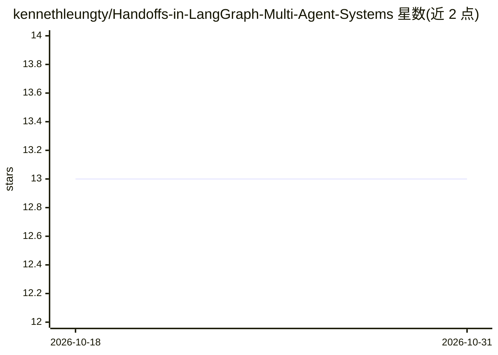

# kennethleungty/Handoffs-in-LangGraph-Multi-Agent-Systems

⭐ 13 · Python · MIT · 推送 2025-12-12 · [GitHub](https://github.com/kennethleungty/Handoffs-in-LangGraph-Multi-Agent-Systems) · [官网](https://towardsdatascience.com/how-agent-handoffs-work-in-multi-agent-systems/) · 个人维护

**演示 LangGraph 多智能体 Handoff 路由模式的示例项目**

配合 Towards Data Science 文章的实践示例：以新加坡房产助手为场景实现多智能体系统，含 Supervisor、交易历史、房源档案三个 Agent，展示两种路由方式——Command-based（`Command.goto` 动态路由 + `Command.update` 状态更新）与 Conditional Edges（基于消息内容的纯路由）。提供两个可运行脚本和 pip 安装说明，供学习多智能体 handoff 机制的开发者参考。

## 筛选速览

| 维度 | 判定 | 备注 |
|---|---|---|
| AI 角色 | `ai-knowledge` | 知识聚合/清单类 |
| 许可风险 | `permissive` | MIT |
| 部署形态 | `library` | 以包/库形式分发 |
| 模型依赖 | — | README 未给出锁定关系 |
| 硬件要求 | — | 无带数字的原话,不猜 |
| 安装摩擦 | `low` | 无编译、无系统依赖或容器化 |
| 成熟度 | — | 结构信号不足 |

## 能力要点

- Supervisor + 2 专家 Agent 的多智能体路由演示
- 对比 Command-based 与 Conditional Edge 两种路由实现
- 附带 towardsdatascience 讲解文章链接

## 适用场景

- 学习 LangGraph 多智能体系统中的 handoff 路由模式
- 对比 Command 与 Conditional Edges 两种路由的适用场景
- 参考多智能体房产问答助手的实现结构

## 场景标签

`多智能体` `教程课程` · 领域:Agent 开发

## 证据(README 行号)

> L3: A practical demo of multi-agent routing patterns using LangGraph, comparing **Command-based routing** vs **Condition
> L5: Read the article here: https://towardsdatascience.com/how-agent-handoffs-work-in-multi-agent-systems/

## 星数曲线

2026-10-18 13 → 2026-10-31 13（+0）

---
*卡片 v1 · prompt 1.4 · 生成 2026-10-31 · 置信度 high · 依据 README sha `3e051b1dead1` · [字段定义](../../DATASET.md)*
