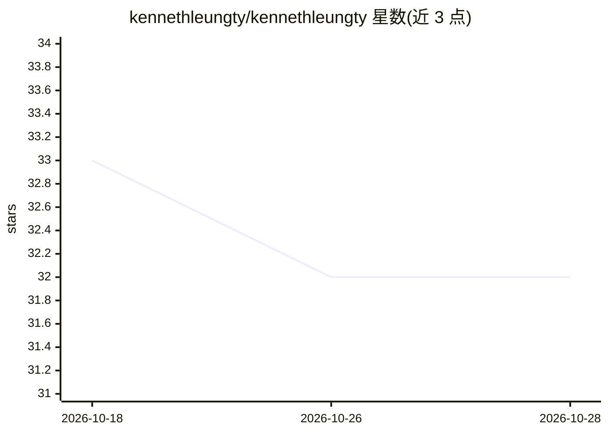

# kennethleungty/kennethleungty

⭐ 32 · 推送 2026-10-18 · [GitHub](https://github.com/kennethleungty/kennethleungty) · 个人维护

**个人数据科学与 AI 技术项目/文章策展目录（20 类）**

Kenneth Leung 的个人技术作品集 README，按云计算、计算机视觉、数据库、生成式 AI 与 Agentic AI、机器学习、MLOps、NLP、负责任 AI 等 20 个类别组织，条目为文章、站点与配套仓库的链接表格，带星标标注个人偏好项目。内容为已发布教程与项目的索引，提供 Topmate 职业咨询入口与 Buy Me A Coffee 赞助链接。不含可安装的软件本体。

## 筛选速览

| 维度 | 判定 | 备注 |
|---|---|---|
| AI 角色 | `ai-knowledge` | 知识聚合/清单类 |
| 许可风险 | `none` | — |
| 部署形态 | `None` |  |
| 模型依赖 | — | README 未给出锁定关系 |
| 硬件要求 | — | 无带数字的原话,不猜 |
| 安装摩擦 | `low` | 无编译、无系统依赖或容器化 |
| 成熟度 | — | 结构信号不足 |

## 能力要点

- 20 个类别组织的技术作品与文章链接目录
- 覆盖生成式 AI/Agentic AI、MLOps、计算机视觉、NLP 等主题
- 部分条目附配套代码仓库链接

## 适用场景

- 浏览查找数据科学与 AI 领域的教程与实践项目
- 按类别了解作者在各技术方向的作品
- 寻找 LLM 本地推理、RAG、MLOps 流水线等主题的实现参考

## 场景标签

`精选清单` · 领域:学习与行业

## 证据(README 行号)

> L25: ## Portfolio Contents
> L33: 8. Generative AI and Agentic AI

## 星数曲线

2026-10-18 33 → 2026-10-28 32（-1）

---
*卡片 v1 · prompt 1.4 · 生成 2026-10-26 · 置信度 high · 依据 README sha `b8d59b9b02c6` · [字段定义](../../DATASET.md)*
