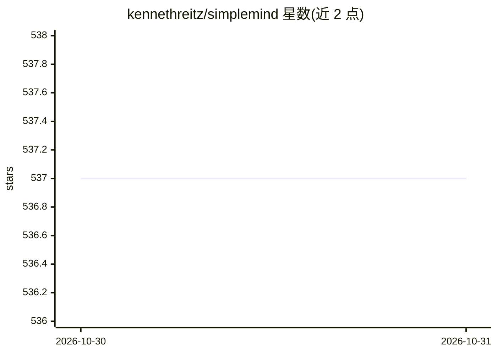

# kennethreitz/simplemind

⭐ 537 · Python · Apache-2.0 · 推送 2026-10-30 · [GitHub](https://github.com/kennethreitz/simplemind) · [官网](https://pypi.org/project/simplemind/) · 个人维护

**给开发者的多 AI 供应商统一 Python 客户端库**

Python 库，为多家 AI 提供商（Anthropic Claude、Amazon Bedrock、Deepseek、Gemini、Groq、Ollama、MiniMax、OpenAI、xAI）提供统一的 API：generate_text 流式文本生成、generate_data 结合 Pydantic 的结构化输出（基于 Instructor）、create_conversation 会话管理，各供应商 API 保持一致。另支持 Session 默认参数、插件机制、函数调用工具及 LLM 自动生成工具 schema 的装饰器（实验性）。通过环境变量配置 API key，用 Logfire 记录日志。仓库描述中声明意图在常见场景替代 LangChain/LangGraph。

## 筛选速览

| 维度 | 判定 | 备注 |
|---|---|---|
| AI 角色 | `ai-ecosystem` | LLM/agent 周边工具 |
| 许可风险 | `permissive` | Apache-2.0 |
| 部署形态 | `library` | 以包/库形式分发 |
| 模型依赖 | local-ok | 支持本地模型 |
| 硬件要求 | — | 无带数字的原话,不猜 |
| 安装摩擦 | `low` | 无编译、无系统依赖或容器化 |
| 成熟度 | `idea` | |

## 能力要点

- 9 家供应商统一 API，llm_provider/llm_model 参数切换
- generate_data 基于 Pydantic/Instructor 输出结构化数据
- 会话插件机制与函数调用工具（含 LLM 自动生成工具 schema 的装饰器）
- Session 类设置调用默认参数并支持逐次覆盖

## 适用场景

- 用统一接口调用多家 LLM 供应商，避免逐家对接 SDK
- 从模型获取符合 Pydantic 模型的结构化数据
- 构建带工具调用与插件的对话应用

## 场景标签

`模型网关` · 领域:Agent 开发

## 证据(README 行号)

> L19: The APIs remain identical between all supported providers / models:
> L62: To specify a specific provider or model, you can use the `llm_provider` and `llm_model` parameters when calling: `g
> L71: $ pip install 'simplemind[full]'

## 星数曲线

2026-10-30 537 → 2026-10-31 537（+0）

---
*卡片 v1 · prompt 1.4 · 生成 2026-10-30 · 置信度 high · 依据 README sha `92d75a6d148b` · [字段定义](../../DATASET.md)*
