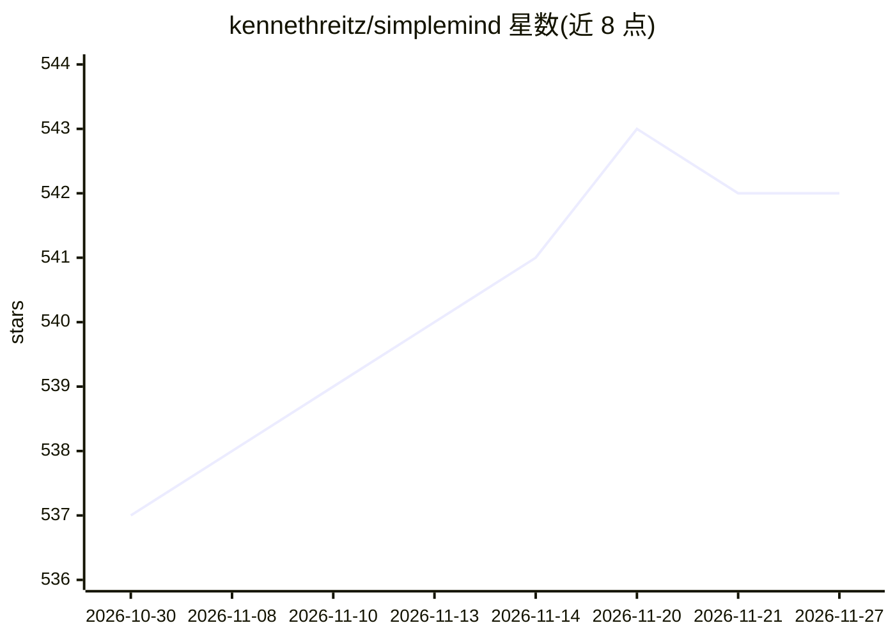

# kennethreitz/simplemind

⭐ 542 · Python · Apache-2.0 · 推送 2026-10-30 · [GitHub](https://github.com/kennethreitz/simplemind) · [官网](https://pypi.org/project/simplemind/) · 个人维护

**面向开发者的多提供商 LLM Python 客户端库**

一个简化 AI API 调用的 Python 库，为多家 LLM 提供商提供一致的接口：generate_text 生成文本、generate_data 生成 Pydantic 结构化输出（借助 Instructor）、create_conversation 多轮对话、Session 设置默认提供商/模型、插件机制扩展会话功能、工具函数调用（含 LLM 自动生成工具 schema 的实验性装饰器）、可选 Logfire 日志。通过环境变量配置各提供商 API key，pip 安装即可使用。自述目标是在多数常见场景中替代 LangChain 与 LangGraph。

## 筛选速览

| 维度 | 判定 | 备注 |
|---|---|---|
| AI 角色 | `ai-ecosystem` | LLM/agent 周边工具 |
| 许可风险 | `permissive` | Apache-2.0 |
| 部署形态 | `library` | 以包/库形式分发 |
| 模型依赖 | local-ok | 支持本地模型 |
| 硬件要求 | — | 无带数字的原话,不猜 |
| 安装摩擦 | `low` | 无编译、无系统依赖或容器化 |
| 成熟度 | — | 结构信号不足 |

## 能力要点

- 多家提供商统一 API：anthropic/bedrock/deepseek/gemini/groq/ollama/minimax/openai/xai
- Pydantic 模型生成结构化输出（基于 Instructor）
- 对话 API、Session 默认参数、插件与工具函数调用
- LLM 自动生成工具定义的 @simplemind.tool 装饰器（实验性）

## 适用场景

- 在 Python 中用一套代码调用多家 LLM API
- 用 Pydantic 从 LLM 响应生成结构化数据
- 快速搭建带函数调用能力的对话应用
- 为常见 LLM 用例寻找比框架更轻量的客户端

## 场景标签

`模型网关` · 领域:Agent 开发

## 证据(README 行号)

> L5: Simplemind is AI library designed to simplify your experience with AI APIs in Python. Inspired by a "for humans" phi
> L17: ## Supported APIs
> L71: $ pip install 'simplemind[full]'

## 星数曲线

2026-10-30 537 → 2026-11-27 542（+5）

---
*卡片 v1 · prompt 1.4 · 生成 2026-11-25 · 置信度 high · 依据 README sha `99a11901b3a1` · [字段定义](../../DATASET.md)*
