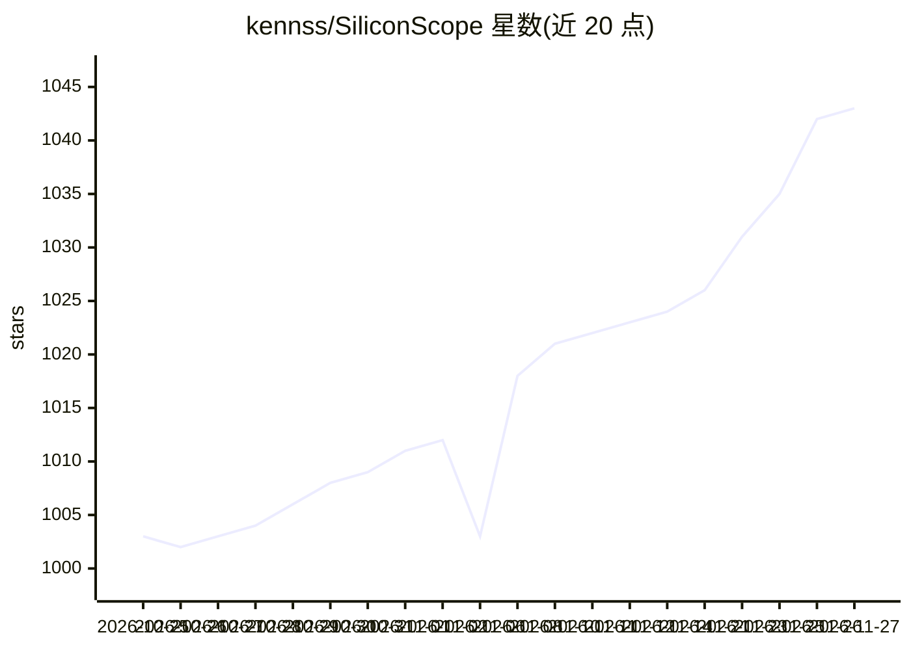

# kennss/SiliconScope

⭐ 1,043 · Swift · MIT · 推送 2026-11-23 · [GitHub](https://github.com/kennss/SiliconScope) · [官网](https://siliconscope.calidalab.ai/) · 个人维护

**无需 sudo 的 Apple Silicon 系统监视器，可观测 ANE/内存带宽等 AI 负载信号**

基于原生 SwiftUI 的 macOS 系统监视器，提供仪表盘与菜单栏套件两种形态，无需 sudo 即可读取 CPU/GPU/内存/网络/磁盘/传感器/电池等指标。针对本地 AI 场景提供 ANE（Neural Engine）活动、Media Engine 与内存带宽追踪、AI 负载瓶颈分类器，以及按模型测量 tokens/sec 与 tokens/Wh 的基准功能。4.0 版支持通过加密 agent 将远程 Mac、Linux GPU 主机或云实例接入同一仪表盘。提供进程级检查器与指标录制回放。要求 macOS 14+ 且为 Apple Silicon 芯片。

## 筛选速览

| 维度 | 判定 | 备注 |
|---|---|---|
| AI 角色 | `ai-enhanced` | 去掉 AI 部分产品仍成立 |
| 许可风险 | `permissive` | MIT |
| 部署形态 | `desktop` | 安装包/桌面程序 |
| 模型依赖 | — | README 未给出锁定关系 |
| 硬件要求 | — | 无带数字的原话,不猜 |
| 安装摩擦 | `low` | 无编译、无系统依赖或容器化 |
| 成熟度 | — | 结构信号不足 |

## 能力要点

- ANE（Neural Engine）活动、功耗与内存占用追踪，含进程级 Neural-Engine 内存
- AI Workload 瓶颈分类器（bandwidth-bound/compute-bound/thermal-throttled/memory-pressured）
- Record & Replay：全部指标录制成 .ssrec 文件并回放
- Fleet 远程机器接入：mDNS 自动发现，TLS 加密与证书固定

## 适用场景

- 观察本地运行 LLM 时 Apple Silicon 各引擎的占用与瓶颈
- 菜单栏实时查看 CPU/GPU/内存/温度/电池指标
- 在多台 Mac/Linux GPU 机器上集中监控硬件状态
- 录制并回放一段时间内的系统指标排查尖峰

## 场景标签

 · 领域:系统监控/开发者工具

## 证据(README 行号)

> L13: A **sudoless Apple Silicon system monitor** — a native SwiftUI dashboard **and** a full
> L202: - **AI Workload view** — a bottleneck classifier (*bandwidth-bound* / *compute-bound* /
> L204:  ceiling — answers "what's limiting my local LLM right now?"

## 星数曲线

2026-10-25 1,003 → 2026-11-27 1,043（+40）

---
*卡片 v1 · prompt 1.4 · 生成 2026-11-24 · 置信度 high · 依据 README sha `a4ee4f6f140c` · [字段定义](../../DATASET.md)*
