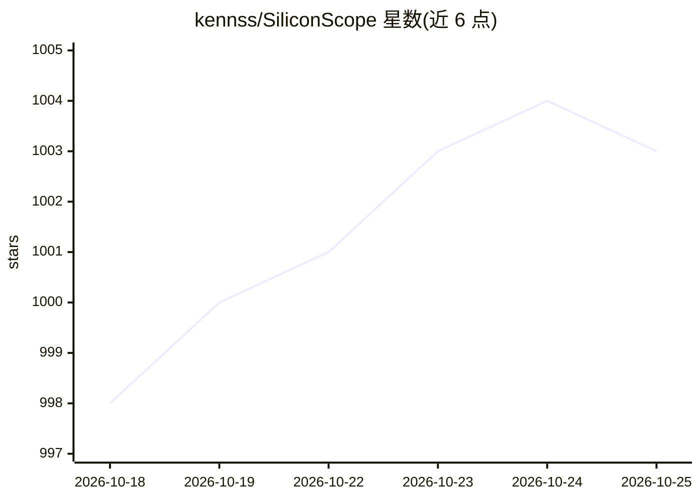

# kennss/SiliconScope

⭐ 1,003 · Swift · MIT · 推送 2026-10-22 · [GitHub](https://github.com/kennss/SiliconScope) · [官网](https://siliconscope.calidalab.ai/) · 个人维护 · 中文 README

**Apple Silicon 系统监视器：显示 ANE/显存带宽等 AI 加速器指标**

原生 SwiftUI 的 macOS 系统监视器，提供仪表盘与菜单栏套件，sudoless 读取 CPU/GPU/ANE（神经引擎）/Media Engine/内存带宽/传感器/电池等指标，并含逐进程 Inspector（含每进程神经引擎内存）、指标录制回放（.ssrec）、本地 LLM 瓶颈分类器（带宽/算力/温度/内存压力）与按模型的 tok/s、tokens/Wh 基准测试。4.0 加入 Fleet：通过加密配对连接监控远程 Mac、Linux GPU 盒与云服务器，显示其 GPU、容器与 Ollama 模型。要求 macOS 14+ Apple Silicon，经 Homebrew cask 或 DMG 安装。

## 筛选速览

| 维度 | 判定 | 备注 |
|---|---|---|
| AI 角色 | `ai-enhanced` | 去掉 AI 部分产品仍成立 |
| 许可风险 | `permissive` | MIT |
| 部署形态 | `desktop` | 安装包/桌面程序 |
| 模型依赖 | — | README 未给出锁定关系 |
| 硬件要求 | — | 无带数字的原话,不猜 |
| 安装摩擦 | `low` | 无编译、无系统依赖或容器化 |
| 成熟度 | — | 结构信号不足 |

## 能力要点

- ANE/Media Engine/内存带宽追踪（Activity Monitor 不显示的信号）
- 逐进程 Inspector：CPU P/E 分离、IPC、功耗、神经引擎内存
- Record & Replay：录制全部指标到 .ssrec 并可回放拖动
- 本地 LLM 瓶颈分类器与 tok/s·tokens/Wh 模型基准测试

## 适用场景

- 查看本地 LLM/Core ML 工作负载对 Apple Silicon 加速器的占用与瓶颈
- 替代 iStat Menus 做日常菜单栏系统监控
- 在同一仪表盘监控远程 Mac mini、Linux GPU 盒与云服务器的 GPU 和容器

## 场景标签

 · 领域:系统工具/性能监控

## 证据(README 行号)

> L13: A **sudoless Apple Silicon system monitor** — a native SwiftUI dashboard **and** a full
> L202: - **AI Workload view** — a bottleneck classifier (*bandwidth-bound* / *compute-bound* /
> L204:  ceiling — answers "what's limiting my local LLM right now?"

## 星数曲线

2026-10-18 998 → 2026-10-25 1,003（+5）

---
*卡片 v1 · prompt 1.4 · 生成 2026-10-21 · 置信度 high · 依据 README sha `46fb62162e5b` · [字段定义](../../DATASET.md)*
