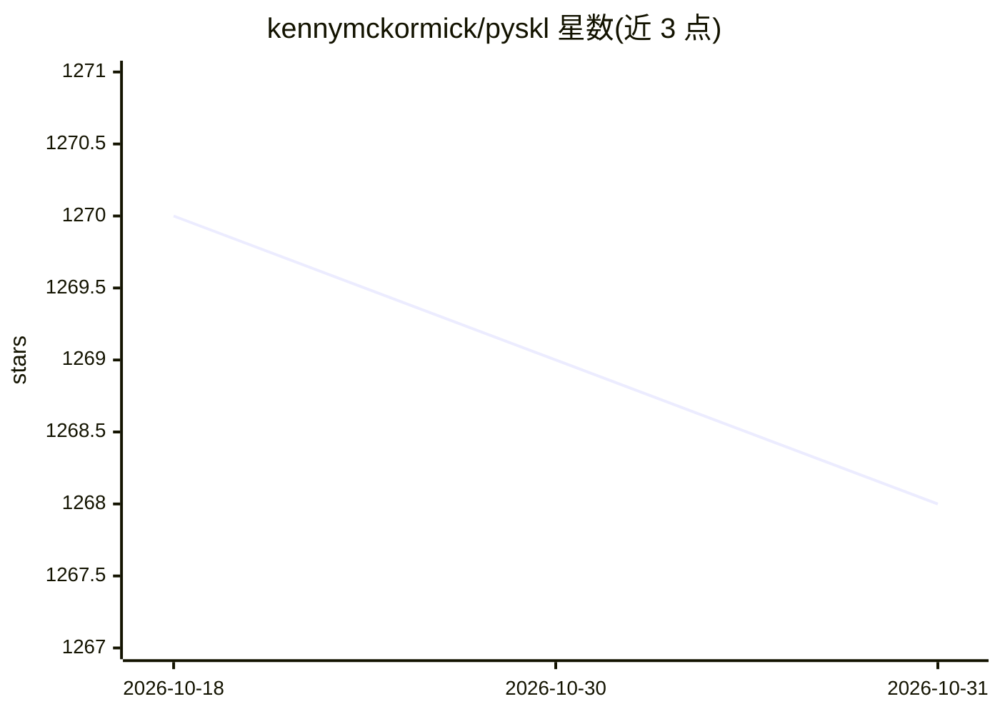

# kennymckormick/pyskl

⭐ 1,268 · Python · Apache-2.0 · 推送 2026-02-19 · [GitHub](https://github.com/kennymckormick/pyskl) · 个人维护

**基于 PyTorch 的骨架动作识别工具箱**

基于 PyTorch 与 MMAction2 构建的骨架动作识别工具箱，是 PoseConv3D 与 STGCN++ 的官方实现，支持 ST-GCN、MS-G3D、CTR-GCN 等 7 种算法，覆盖 NTURGB+D、Kinetics 400、FineGYM 等 6 个数据集。提供预处理骨架标注的 pickle 文件、从 RGB 视频提取 HRNet 2D 骨架的脚本、骨架可视化工具，并支持单机多卡分布式训练与测试。安装依赖 conda 环境文件与 pip。仓库已声明不再由开发者维护。

## 筛选速览

| 维度 | 判定 | 备注 |
|---|---|---|
| AI 角色 | `ai-native` | 本体是模型或模型工具 |
| 许可风险 | `permissive` | Apache-2.0 |
| 部署形态 | `library` | 以包/库形式分发 |
| 模型依赖 | — | README 未给出锁定关系 |
| 硬件要求 | — | 无带数字的原话,不猜 |
| 安装摩擦 | `low` | 无编译、无系统依赖或容器化 |
| 成熟度 | — | 结构信号不足 |

## 能力要点

- 支持 7 种骨架动作识别算法（ST-GCN/PoseConv3D/CTR-GCN 等）
- 覆盖 6 个骨架数据集并提供预处理标注
- 提供从 RGB 视频提取 HRNet 2D 骨架的脚本
- 支持单机多 GPU 分布式训练与测试

## 适用场景

- 训练或复现骨架动作识别模型
- 为自己的 RGB 视频数据集提取骨架并训练识别模型
- 在 NTU-RGB+D 等数据集上做动作识别研究实验

## 场景标签

`图像视频处理` `模型训练` · 领域:感知与多模态

## 证据(README 行号)

> L10: PYSKL is a toolbox focusing on action recognition based on **SK**e**L**eton data with **PY**Torch. Various algorith
> L27: - [x] PoseConv3D (CVPR 2022 Oral) [MODELZOO]

## 星数曲线

2026-10-18 1,270 → 2026-10-31 1,268（-2）

---
*卡片 v1 · prompt 1.4 · 生成 2026-10-21 · 置信度 high · 依据 README sha `b09770fd9a11` · [字段定义](../../DATASET.md)*
