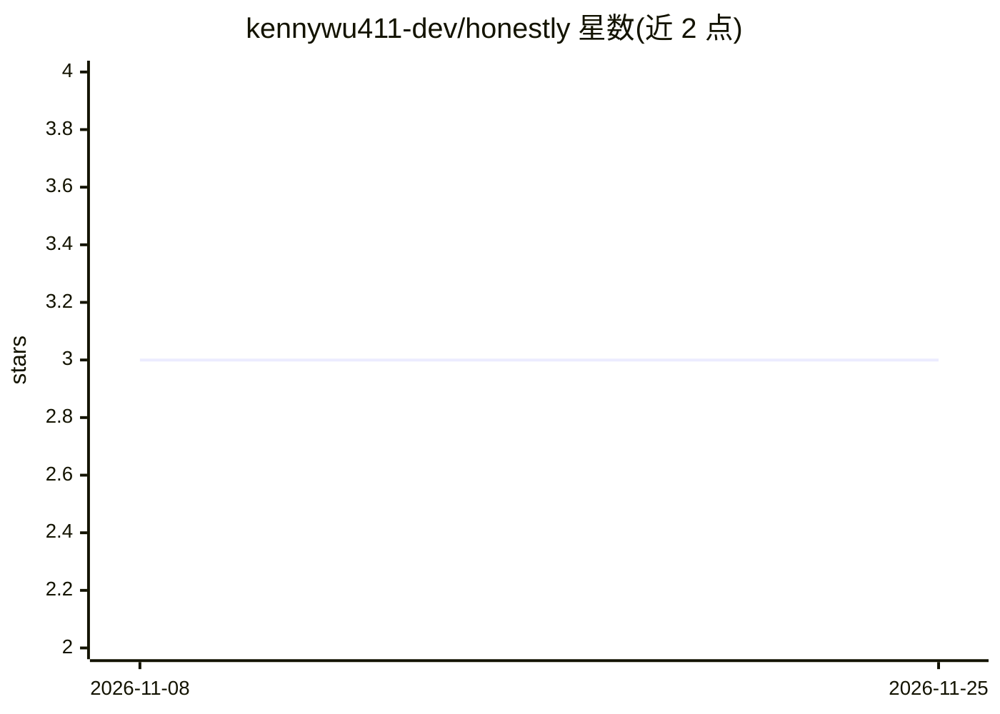

# kennywu411-dev/honestly

⭐ 3 · Python · MIT · 推送 2026-11-23 · [GitHub](https://github.com/kennywu411-dev/honestly) · [官网](https://pypi.org/project/honestly/) · 个人维护 · 中文 README

**拦截 AI 编码代理“测试通过”虚报的确定性 hook 工具**

面向使用 Claude Code、Codex 等 AI 编码代理的开发者：代理在最后一次代码编辑后未真正运行测试/构建/部署等命令，却声称“测试通过”时，honesty 通过读取会话 transcript、匹配声明与后续工具调用输出，将该回复拦截并要求代理先执行真实检查。机制为确定性规则，不做模型调用、不需要 API key；覆盖 14 类声明（测试、lint、构建、push、部署等），并阻止会截断输出的管道命令。以 Claude Code 插件或 pip 包安装，Cursor 与 Gemini CLI 支持为实验性。

## 筛选速览

| 维度 | 判定 | 备注 |
|---|---|---|
| AI 角色 | `ai-ecosystem` | LLM/agent 周边工具 |
| 许可风险 | `permissive` | MIT |
| 部署形态 | `library` | 以包/库形式分发 |
| 模型依赖 | — | README 未给出锁定关系 |
| 硬件要求 | — | 无带数字的原话,不猜 |
| 安装摩擦 | `medium` | 含编译或系统依赖之一 |
| 成熟度 | — | 结构信号不足 |

## 能力要点

- 确定性 hook 规则，无模型调用、无 API key，本地运行不外传数据
- 14 类声明核验（tests/lint/build/deploy/sent 等），读取子代理产出作为证据
- 拒绝会截断结果的管道命令（如 pytest | head）并给出修正建议
- 拦截记录写入本地 catches.jsonl，支持审计、统计卡片与桌面通知

## 适用场景

- 防止代理在未跑测试时回复“全部测试通过”
- 核对代理声称的部署、push、发邮件等操作是否真的发生
- 团队中审计 AI 编码会话中未经证实的“完成”声明

## 场景标签

`编码 Agent` · 领域:编码与开发

## 证据(README 行号)

> L6: Hooks for Claude Code and Codex · deterministic rules, no model calls · nothing about your work leaves your machine
> L20: An agent edits `login.py`, remembers that the tests passed ten minutes ago, and writes *"Fixed, all 12 tests pass"*
> L48: Other assistants. Codex is verified end to end on a real machine (Codex CLI 0.163: the guard denied a piped `pytest

## 星数曲线

2026-11-08 3 → 2026-11-25 3（+0）

---
*卡片 v1 · prompt 1.4 · 生成 2026-11-21 · 置信度 high · 依据 README sha `dabd9c47a71a` · [字段定义](../../DATASET.md)*
