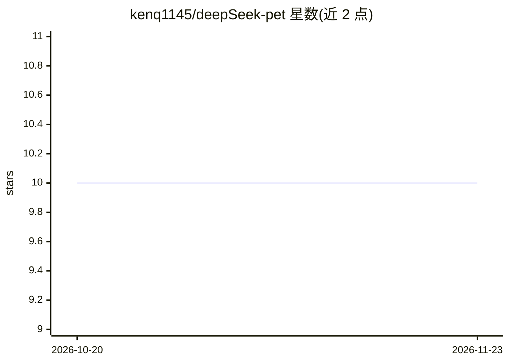

# kenq1145/deepSeek-pet

⭐ 10 · TypeScript · MIT · 推送 2026-09-29 · [GitHub](https://github.com/kenq1145/deepSeek-pet) · 个人维护 · 中文 README

**桌宠应用：给桌面玩家带来有自主行为与可选对话能力的电子宠物**

Electron + three.js 构建的 Windows 桌面宠物，由一张立绘分层并程序化生成骨架渲染。核心机制为四项需求（休息、陪伴、玩耍、安全）驱动的行为评分系统，行为选择与心情在日志中留有可解释理由。支持拖拽/抛掷物理、18 种表情、对话指令驱动动作。可选接入 DeepSeek API 使其说话与周期性思考；无 key 时完全离线运行且不发起网络请求。MIT 许可，立绘版权不随代码开放。

## 筛选速览

| 维度 | 判定 | 备注 |
|---|---|---|
| AI 角色 | `ai-enhanced` | 去掉 AI 部分产品仍成立 |
| 许可风险 | `permissive` | MIT |
| 部署形态 | `library` | 以包/库形式分发 |
| 模型依赖 | locked-api |  |
| 硬件要求 | — | 无带数字的原话,不猜 |
| 安装摩擦 | `low` | 无编译、无系统依赖或容器化 |
| 成熟度 | — | 结构信号不足 |

## 能力要点

- 四项需求驱动的行为评分与可解释日志
- 拾取/抛掷物理与 18 种绘制表情
- 可选 DeepSeek 大脑，无 key 时零网络请求
- 脚本从单张立绘自动派生骨骼

## 适用场景

- 在 Windows 桌面养一只可交互的电子宠物
- 通过聊天框用自然语言让她跳舞、坐下、睡觉
- 研究需求驱动的虚拟角色行为设计

## 场景标签

`聊天机器人` · 领域:对话与助手

## 证据(README 行号)

> L3:  A desktop pet with a mind of her own.
> L24: same needs, so her face and her behaviour can never disagree. An optional DeepSeek
> L25: brain gives her a voice and a personality on top; she works completely without it.

## 星数曲线

2026-10-20 10 → 2026-11-23 10（+0）

---
*卡片 v1 · prompt 1.4 · 生成 2026-11-19 · 置信度 mid · 依据 README sha `24ef9cbdb6e8` · [字段定义](../../DATASET.md)*
