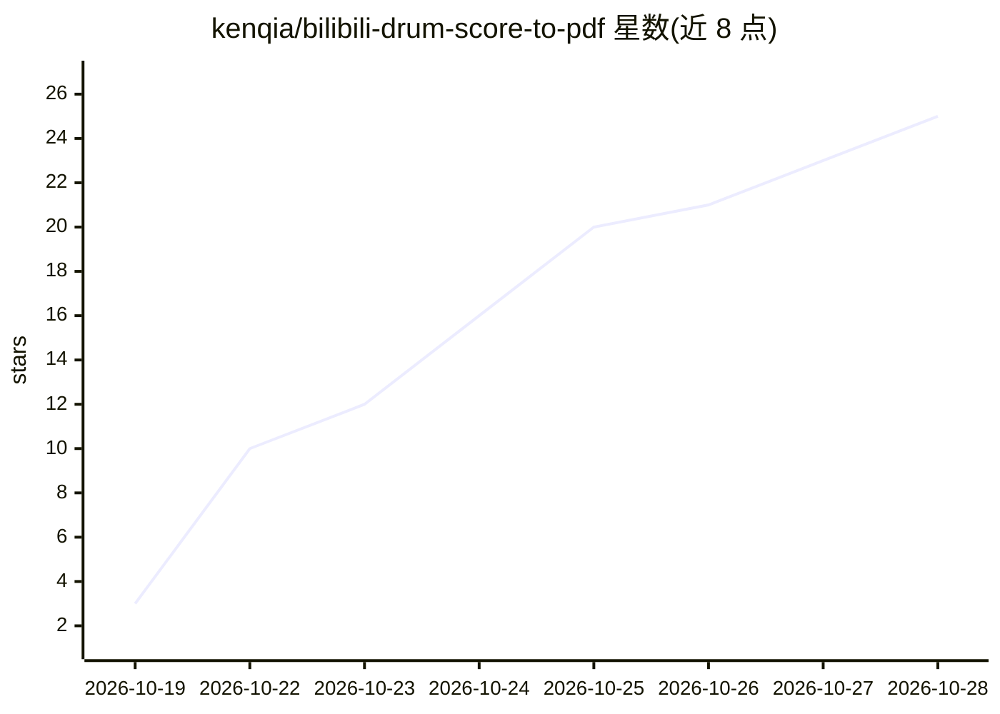

# kenqia/bilibili-drum-score-to-pdf

⭐ 26 · Python · MIT · 推送 2026-10-28 · [GitHub](https://github.com/kenqia/bilibili-drum-score-to-pdf) · [官网](https://drum.kenqia.top) · 个人维护 · 中文 README

**把B站滚动鼓谱视频拼接为可打印A4 PDF的网页工具**

面向鼓手的鼓谱整理工具：用户粘贴B站视频链接，网页自动跟踪视频滚动，把逐行滚动的鼓谱拼接成完整页面并排版为A4 PDF，重复段按原样保留，结果保留24小时。网站部分为纯图像处理，README 明确声明不调用 AI 模型、不重新识别音符；仓库另含一个供 Codex 等视觉 Agent 使用的独立 Skill，可由 Agent 逐页查看交付并支持可选重绘。同时提供 Python 命令行工具处理本地视频，需 Python 3.12+ 及 ffmpeg/ffprobe/pdftoppm。

## 筛选速览

| 维度 | 判定 | 备注 |
|---|---|---|
| AI 角色 | `ai-enhanced` | 去掉 AI 部分产品仍成立 |
| 许可风险 | `permissive` | MIT |
| 部署形态 | `library` | 以包/库形式分发 |
| 模型依赖 | — | README 未给出锁定关系 |
| 硬件要求 | — | 无带数字的原话,不猜 |
| 安装摩擦 | `medium` | 含编译或系统依赖之一 |
| 成熟度 | — | 结构信号不足 |

## 能力要点

- 自动跟踪视频滚动完成整行拼接，重叠部分只保留一次
- 纯图像处理，不调用 AI 模型、不改动或重新识别音符
- 仓库含独立 AI Agent Skill（skills/bilibili-drum-score-to-pdf），供视觉 Agent 使用
- 提供 Python 命令行工具，支持本地视频处理

## 适用场景

- 把B站滚动鼓谱视频变成能打印放上谱架的 A4 PDF
- 免去手动暂停截图拼谱的流程
- 鼓手用手机或电脑粘贴链接直接获取可打印谱面

## 场景标签

`图像视频处理` · 领域:感知与多模态

## 证据(README 行号)

> L83: |Python 命令行与网站|`src/drum_score/`|网站 drum.kenqia.top 的源码。纯图像处理，不调用 AI 模型。支持本地视频。|
> L84: |AI Agent Skill|`skills/bilibili-drum-score-to-pdf/`|给 Codex 等视觉 Agent 使用，可由 Agent 逐页查看后交付，并支持可选重绘。|

## 星数曲线

2026-10-19 3 → 2026-10-28 25（+22）

---
*卡片 v1 · prompt 1.4 · 生成 2026-10-27 · 置信度 high · 依据 README sha `f427ed1b3a36` · [字段定义](../../DATASET.md)*
