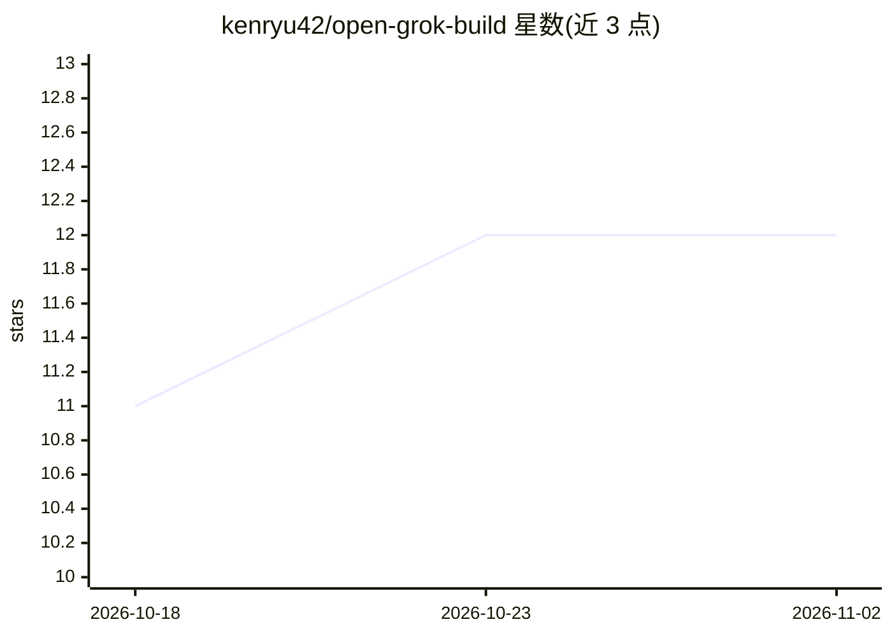

# kenryu42/open-grok-build

⭐ 12 · TypeScript · MIT · 推送 2026-10-01 · [GitHub](https://github.com/kenryu42/open-grok-build) · 个人维护

**OpenCode 插件：以 xAI OAuth 接入 Grok Build 模型并轮换多账号配额**

面向 OpenCode（需 2.0+）的插件，将 Grok Build 接入为模型提供方：通过浏览器、设备码或粘贴回调码完成 xAI OAuth 登录，凭据由 OpenCode 存储与刷新。支持多账号管理与私有本地仪表盘，账户余额耗尽或认证失败时自动轮换到剩余配额最多的账号；提供订阅档位、周配额与重置时间的用量查询，内置 10 个模型目录与 reasoning-effort 变体，另含 Grok Imagine 图像生成/编辑命令与 image_gen 工具。非官方社区集成，不绕过 xAI 配额与计费；模型可用性因账号、地区而异。

## 筛选速览

| 维度 | 判定 | 备注 |
|---|---|---|
| AI 角色 | `ai-ecosystem` | LLM/agent 周边工具 |
| 许可风险 | `permissive` | MIT |
| 部署形态 | `None` |  |
| 模型依赖 | locked-api |  |
| 硬件要求 | — | 无带数字的原话,不猜 |
| 安装摩擦 | `low` | 无编译、无系统依赖或容器化 |
| 成熟度 | — | 结构信号不足 |

## 能力要点

- xAI OAuth 登录（浏览器/设备码/环境变量 token），凭据由 OpenCode 管理
- 多账号配额自动轮换：余额耗尽或认证失败时切换并重试
- 10 个模型目录，支持 #low/#medium/#high/#xhigh reasoning-effort 变体
- Grok Imagine 图像生成/编辑：斜杠命令与 image_gen 工具双通道

## 适用场景

- 在 OpenCode 中直接使用 Grok Build 模型进行编码
- 多账号场景下自动切换以应对配额耗尽
- 在编码会话内生成或编辑图片

## 场景标签

`编码 Agent` `图像生成` · 领域:编码与开发

## 证据(README 行号)

> L9: Use Grok Build models in OpenCode with OAuth, account rotation, quota tracking, and Grok Imagine image generation.
> L17: > Requires OpenCode 2.0 or newer and an xAI account with access to the selected model. Availability varies by accou
> L40: Restart OpenCode. The single entry loads both halves of the package — the server plugin (provider, authentication, 

## 星数曲线

2026-10-18 11 → 2026-11-02 12（+1）

---
*卡片 v1 · prompt 1.4 · 生成 2026-11-01 · 置信度 high · 依据 README sha `009c71e4c9ab` · [字段定义](../../DATASET.md)*
