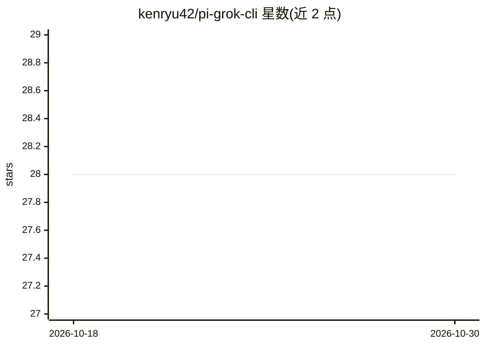

# kenryu42/pi-grok-cli

⭐ 28 · TypeScript · MIT · 推送 2026-10-09 · [GitHub](https://github.com/kenryu42/pi-grok-cli) · [官网](https://pi.dev/packages/pi-grok-cli) · 个人维护

**让 pi 编码 agent 使用 X Premium/SuperGrok 订阅的 Grok 扩展**

pi 编码 agent 的社区扩展：通过浏览器或设备码 OAuth 登录 xAI/Grok 账号，在 pi 中以 grok-cli provider 使用订阅额度。支持多账号管理与配额耗尽时自动轮换、查询订阅档位与周配额、Grok Imagine 图像生成与编辑（image_gen 工具）、原生图像输入。内置 10 个模型条目（上下文 200K–2M）。非官方集成，不绕过 xAI 的访问控制、配额或计费；需 pi 0.86.0 及以上。

## 筛选速览

| 维度 | 判定 | 备注 |
|---|---|---|
| AI 角色 | `ai-ecosystem` | LLM/agent 周边工具 |
| 许可风险 | `permissive` | MIT |
| 部署形态 | `None` |  |
| 模型依赖 | locked-api |  |
| 硬件要求 | — | 无带数字的原话,不猜 |
| 安装摩擦 | `low` | 无编译、无系统依赖或容器化 |
| 成熟度 | — | 结构信号不足 |

## 能力要点

- OAuth 浏览器/设备码登录并自动刷新 token
- 多账号管理，配额耗尽时自动切换到剩余额度最多的账号
- Grok Imagine 图像生成与本地图片编辑（≤400 KiB）
- 订阅档位、周配额用量与重置时间查询

## 适用场景

- 在 pi 中用已有的 X Premium/SuperGrok 订阅跑 Grok 模型
- 多账号轮换以应对每周配额限制
- 在编码会话中直接生成或编辑图片

## 场景标签

`编码 Agent` `图像生成` · 领域:编码与开发

## 证据(README 行号)

> L9: Use your X Premium or SuperGrok subscription in pi with a clean, focused toolset.
> L26: pi install npm:pi-grok-cli

## 星数曲线

2026-10-18 28 → 2026-10-30 28（+0）

---
*卡片 v1 · prompt 1.4 · 生成 2026-10-26 · 置信度 high · 依据 README sha `d233a090b1ff` · [字段定义](../../DATASET.md)*
